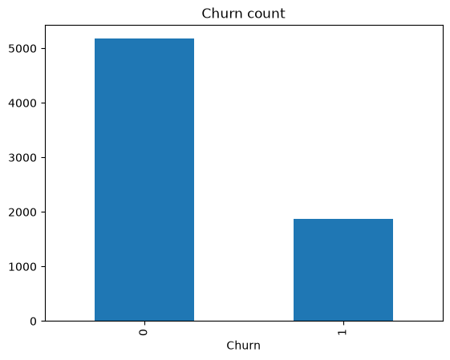
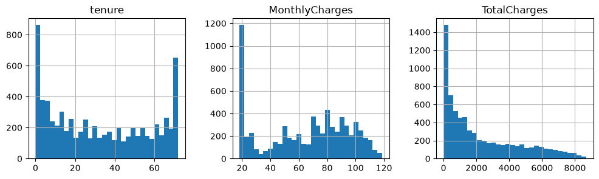
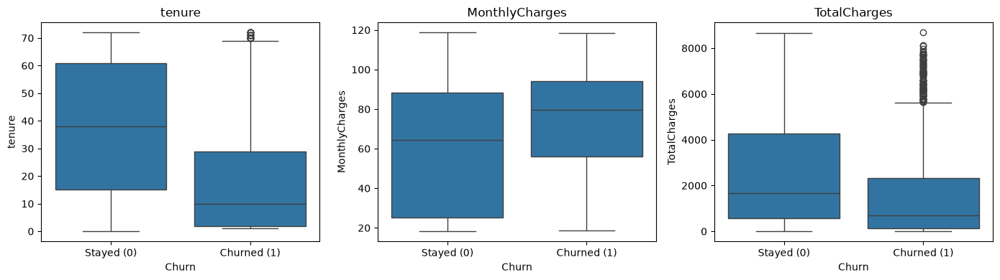
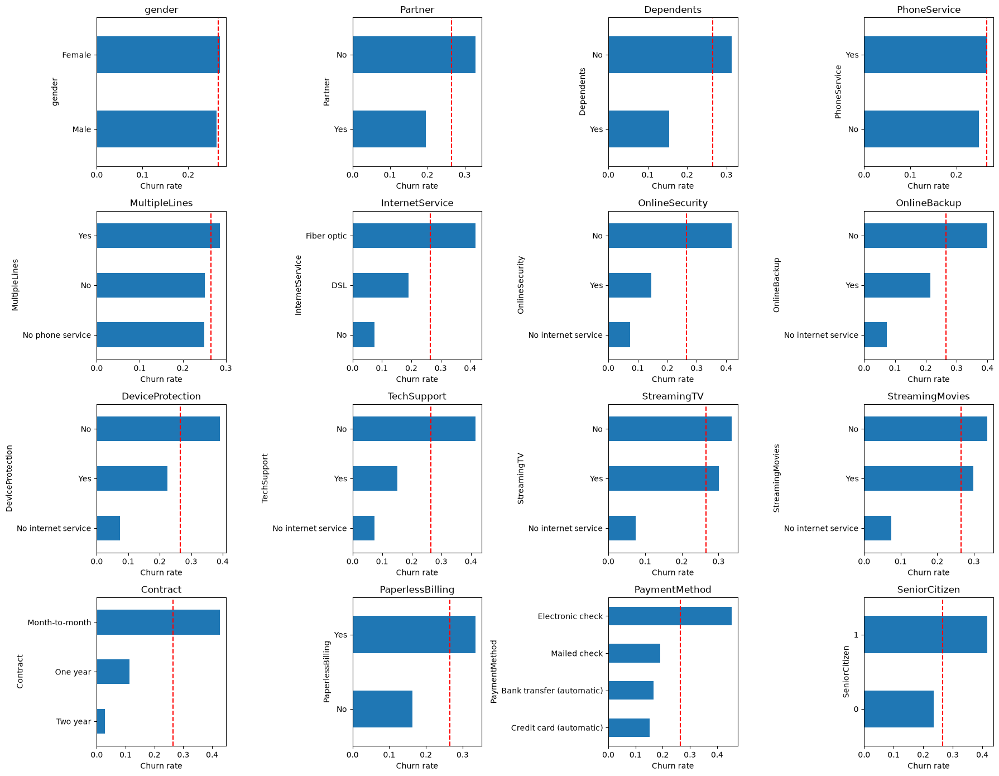
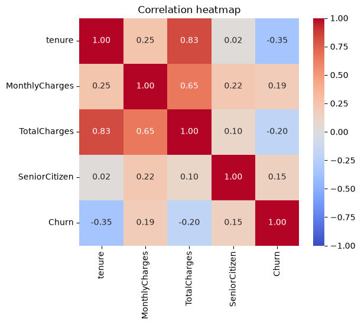
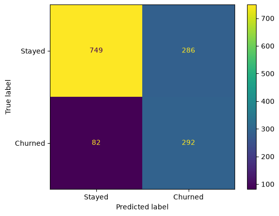
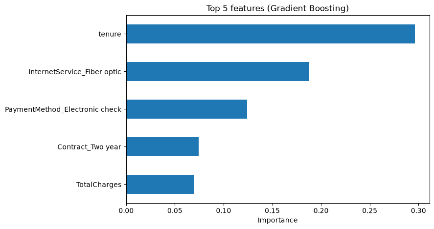
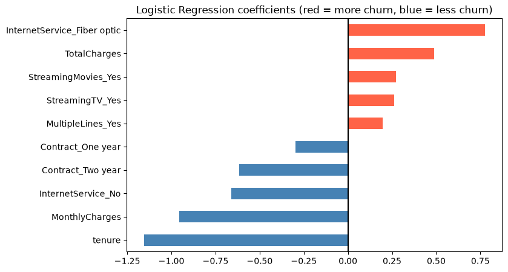

```python
import pandas as pd
df = pd.read_csv("../data/Telco-Customer-Churn.csv")
df.head()
```


<div>
<style scoped>
    .dataframe tbody tr th:only-of-type {
        vertical-align: middle;
    }

    .dataframe tbody tr th {
        vertical-align: top;
    }

    .dataframe thead th {
        text-align: right;
    }
</style>
<table border="1" class="dataframe">
  <thead>
    <tr style="text-align: right;">
      <th></th>
      <th>customerID</th>
      <th>gender</th>
      <th>SeniorCitizen</th>
      <th>Partner</th>
      <th>Dependents</th>
      <th>tenure</th>
      <th>PhoneService</th>
      <th>MultipleLines</th>
      <th>InternetService</th>
      <th>OnlineSecurity</th>
      <th>...</th>
      <th>DeviceProtection</th>
      <th>TechSupport</th>
      <th>StreamingTV</th>
      <th>StreamingMovies</th>
      <th>Contract</th>
      <th>PaperlessBilling</th>
      <th>PaymentMethod</th>
      <th>MonthlyCharges</th>
      <th>TotalCharges</th>
      <th>Churn</th>
    </tr>
  </thead>
  <tbody>
    <tr>
      <th>0</th>
      <td>7590-VHVEG</td>
      <td>Female</td>
      <td>0</td>
      <td>Yes</td>
      <td>No</td>
      <td>1</td>
      <td>No</td>
      <td>No phone service</td>
      <td>DSL</td>
      <td>No</td>
      <td>...</td>
      <td>No</td>
      <td>No</td>
      <td>No</td>
      <td>No</td>
      <td>Month-to-month</td>
      <td>Yes</td>
      <td>Electronic check</td>
      <td>29.85</td>
      <td>29.85</td>
      <td>No</td>
    </tr>
    <tr>
      <th>1</th>
      <td>5575-GNVDE</td>
      <td>Male</td>
      <td>0</td>
      <td>No</td>
      <td>No</td>
      <td>34</td>
      <td>Yes</td>
      <td>No</td>
      <td>DSL</td>
      <td>Yes</td>
      <td>...</td>
      <td>Yes</td>
      <td>No</td>
      <td>No</td>
      <td>No</td>
      <td>One year</td>
      <td>No</td>
      <td>Mailed check</td>
      <td>56.95</td>
      <td>1889.5</td>
      <td>No</td>
    </tr>
    <tr>
      <th>2</th>
      <td>3668-QPYBK</td>
      <td>Male</td>
      <td>0</td>
      <td>No</td>
      <td>No</td>
      <td>2</td>
      <td>Yes</td>
      <td>No</td>
      <td>DSL</td>
      <td>Yes</td>
      <td>...</td>
      <td>No</td>
      <td>No</td>
      <td>No</td>
      <td>No</td>
      <td>Month-to-month</td>
      <td>Yes</td>
      <td>Mailed check</td>
      <td>53.85</td>
      <td>108.15</td>
      <td>Yes</td>
    </tr>
    <tr>
      <th>3</th>
      <td>7795-CFOCW</td>
      <td>Male</td>
      <td>0</td>
      <td>No</td>
      <td>No</td>
      <td>45</td>
      <td>No</td>
      <td>No phone service</td>
      <td>DSL</td>
      <td>Yes</td>
      <td>...</td>
      <td>Yes</td>
      <td>Yes</td>
      <td>No</td>
      <td>No</td>
      <td>One year</td>
      <td>No</td>
      <td>Bank transfer (automatic)</td>
      <td>42.30</td>
      <td>1840.75</td>
      <td>No</td>
    </tr>
    <tr>
      <th>4</th>
      <td>9237-HQITU</td>
      <td>Female</td>
      <td>0</td>
      <td>No</td>
      <td>No</td>
      <td>2</td>
      <td>Yes</td>
      <td>No</td>
      <td>Fiber optic</td>
      <td>No</td>
      <td>...</td>
      <td>No</td>
      <td>No</td>
      <td>No</td>
      <td>No</td>
      <td>Month-to-month</td>
      <td>Yes</td>
      <td>Electronic check</td>
      <td>70.70</td>
      <td>151.65</td>
      <td>Yes</td>
    </tr>
  </tbody>
</table>
<p>5 rows × 21 columns</p>
</div>


```python
df.shape
df.info()
```

    <class 'pandas.DataFrame'>
    RangeIndex: 7043 entries, 0 to 7042
    Data columns (total 21 columns):
     #   Column            Non-Null Count  Dtype  
    ---  ------            --------------  -----  
     0   customerID        7043 non-null   str    
     1   gender            7043 non-null   str    
     2   SeniorCitizen     7043 non-null   int64  
     3   Partner           7043 non-null   str    
     4   Dependents        7043 non-null   str    
     5   tenure            7043 non-null   int64  
     6   PhoneService      7043 non-null   str    
     7   MultipleLines     7043 non-null   str    
     8   InternetService   7043 non-null   str    
     9   OnlineSecurity    7043 non-null   str    
     10  OnlineBackup      7043 non-null   str    
     11  DeviceProtection  7043 non-null   str    
     12  TechSupport       7043 non-null   str    
     13  StreamingTV       7043 non-null   str    
     14  StreamingMovies   7043 non-null   str    
     15  Contract          7043 non-null   str    
     16  PaperlessBilling  7043 non-null   str    
     17  PaymentMethod     7043 non-null   str    
     18  MonthlyCharges    7043 non-null   float64
     19  TotalCharges      7043 non-null   str    
     20  Churn             7043 non-null   str    
    dtypes: float64(1), int64(2), str(18)
    memory usage: 1.1 MB
    

There is a issue on the column TotalCharges as it is a numerical filed but the data type is str which is wrong. So it need to further analysis


```python
df.describe()
```


<div>
<style scoped>
    .dataframe tbody tr th:only-of-type {
        vertical-align: middle;
    }

    .dataframe tbody tr th {
        vertical-align: top;
    }

    .dataframe thead th {
        text-align: right;
    }
</style>
<table border="1" class="dataframe">
  <thead>
    <tr style="text-align: right;">
      <th></th>
      <th>SeniorCitizen</th>
      <th>tenure</th>
      <th>MonthlyCharges</th>
    </tr>
  </thead>
  <tbody>
    <tr>
      <th>count</th>
      <td>7043.000000</td>
      <td>7043.000000</td>
      <td>7043.000000</td>
    </tr>
    <tr>
      <th>mean</th>
      <td>0.162147</td>
      <td>32.371149</td>
      <td>64.761692</td>
    </tr>
    <tr>
      <th>std</th>
      <td>0.368612</td>
      <td>24.559481</td>
      <td>30.090047</td>
    </tr>
    <tr>
      <th>min</th>
      <td>0.000000</td>
      <td>0.000000</td>
      <td>18.250000</td>
    </tr>
    <tr>
      <th>25%</th>
      <td>0.000000</td>
      <td>9.000000</td>
      <td>35.500000</td>
    </tr>
    <tr>
      <th>50%</th>
      <td>0.000000</td>
      <td>29.000000</td>
      <td>70.350000</td>
    </tr>
    <tr>
      <th>75%</th>
      <td>0.000000</td>
      <td>55.000000</td>
      <td>89.850000</td>
    </tr>
    <tr>
      <th>max</th>
      <td>1.000000</td>
      <td>72.000000</td>
      <td>118.750000</td>
    </tr>
  </tbody>
</table>
</div>


```python
blank = df["TotalCharges"].str.strip() == ""
print(blank.sum())
```

    11
    

TotalCharges have 11 empty or blank space that need to fix with numeric value


```python
df["Churn"].value_counts(normalize=True)
```


    Churn
    No     0.73463
    Yes    0.26537
    Name: proportion, dtype: float64


So about 26% customer churn and 73% stayed


```python
nums = pd.to_numeric(df["TotalCharges"], errors="coerce")
print(nums.isna().sum())
```

    11
    

So TotalCharges is filled with the approprited value so our string value become actaul float and empty value will Nan


```python
df["TotalCharges"] = pd.to_numeric(df["TotalCharges"], errors="coerce").fillna(0)
print(df["TotalCharges"].dtype)
print(df["TotalCharges"].isna().sum())
```

    float64
    0
    

So filled it with 0. Now the we need to remove the unnessary coloum such as customer id as it won't have any significat to predict the churn


```python
df = df.drop(columns="customerID")
```


```python
df["Churn"] = df["Churn"].map({"Yes": 1, "No": 0})
```

Need to convert the Churn "YES" "NO" value to binary for better model understanding


```python
df.head()
```


<div>
<style scoped>
    .dataframe tbody tr th:only-of-type {
        vertical-align: middle;
    }

    .dataframe tbody tr th {
        vertical-align: top;
    }

    .dataframe thead th {
        text-align: right;
    }
</style>
<table border="1" class="dataframe">
  <thead>
    <tr style="text-align: right;">
      <th></th>
      <th>gender</th>
      <th>SeniorCitizen</th>
      <th>Partner</th>
      <th>Dependents</th>
      <th>tenure</th>
      <th>PhoneService</th>
      <th>MultipleLines</th>
      <th>InternetService</th>
      <th>OnlineSecurity</th>
      <th>OnlineBackup</th>
      <th>DeviceProtection</th>
      <th>TechSupport</th>
      <th>StreamingTV</th>
      <th>StreamingMovies</th>
      <th>Contract</th>
      <th>PaperlessBilling</th>
      <th>PaymentMethod</th>
      <th>MonthlyCharges</th>
      <th>TotalCharges</th>
      <th>Churn</th>
    </tr>
  </thead>
  <tbody>
    <tr>
      <th>0</th>
      <td>Female</td>
      <td>0</td>
      <td>Yes</td>
      <td>No</td>
      <td>1</td>
      <td>No</td>
      <td>No phone service</td>
      <td>DSL</td>
      <td>No</td>
      <td>Yes</td>
      <td>No</td>
      <td>No</td>
      <td>No</td>
      <td>No</td>
      <td>Month-to-month</td>
      <td>Yes</td>
      <td>Electronic check</td>
      <td>29.85</td>
      <td>29.85</td>
      <td>0</td>
    </tr>
    <tr>
      <th>1</th>
      <td>Male</td>
      <td>0</td>
      <td>No</td>
      <td>No</td>
      <td>34</td>
      <td>Yes</td>
      <td>No</td>
      <td>DSL</td>
      <td>Yes</td>
      <td>No</td>
      <td>Yes</td>
      <td>No</td>
      <td>No</td>
      <td>No</td>
      <td>One year</td>
      <td>No</td>
      <td>Mailed check</td>
      <td>56.95</td>
      <td>1889.50</td>
      <td>0</td>
    </tr>
    <tr>
      <th>2</th>
      <td>Male</td>
      <td>0</td>
      <td>No</td>
      <td>No</td>
      <td>2</td>
      <td>Yes</td>
      <td>No</td>
      <td>DSL</td>
      <td>Yes</td>
      <td>Yes</td>
      <td>No</td>
      <td>No</td>
      <td>No</td>
      <td>No</td>
      <td>Month-to-month</td>
      <td>Yes</td>
      <td>Mailed check</td>
      <td>53.85</td>
      <td>108.15</td>
      <td>1</td>
    </tr>
    <tr>
      <th>3</th>
      <td>Male</td>
      <td>0</td>
      <td>No</td>
      <td>No</td>
      <td>45</td>
      <td>No</td>
      <td>No phone service</td>
      <td>DSL</td>
      <td>Yes</td>
      <td>No</td>
      <td>Yes</td>
      <td>Yes</td>
      <td>No</td>
      <td>No</td>
      <td>One year</td>
      <td>No</td>
      <td>Bank transfer (automatic)</td>
      <td>42.30</td>
      <td>1840.75</td>
      <td>0</td>
    </tr>
    <tr>
      <th>4</th>
      <td>Female</td>
      <td>0</td>
      <td>No</td>
      <td>No</td>
      <td>2</td>
      <td>Yes</td>
      <td>No</td>
      <td>Fiber optic</td>
      <td>No</td>
      <td>No</td>
      <td>No</td>
      <td>No</td>
      <td>No</td>
      <td>No</td>
      <td>Month-to-month</td>
      <td>Yes</td>
      <td>Electronic check</td>
      <td>70.70</td>
      <td>151.65</td>
      <td>1</td>
    </tr>
  </tbody>
</table>
</div>


```python
df.isna().sum()
```


    gender              0
    SeniorCitizen       0
    Partner             0
    Dependents          0
    tenure              0
    PhoneService        0
    MultipleLines       0
    InternetService     0
    OnlineSecurity      0
    OnlineBackup        0
    DeviceProtection    0
    TechSupport         0
    StreamingTV         0
    StreamingMovies     0
    Contract            0
    PaperlessBilling    0
    PaymentMethod       0
    MonthlyCharges      0
    TotalCharges        0
    Churn               0
    dtype: int64


The data is almost okay as no missing value in any colum is here so far


```python
df.isna().sum().sum()
```


    np.int64(0)


```python
df.info()
```

    <class 'pandas.DataFrame'>
    RangeIndex: 7043 entries, 0 to 7042
    Data columns (total 20 columns):
     #   Column            Non-Null Count  Dtype  
    ---  ------            --------------  -----  
     0   gender            7043 non-null   str    
     1   SeniorCitizen     7043 non-null   int64  
     2   Partner           7043 non-null   str    
     3   Dependents        7043 non-null   str    
     4   tenure            7043 non-null   int64  
     5   PhoneService      7043 non-null   str    
     6   MultipleLines     7043 non-null   str    
     7   InternetService   7043 non-null   str    
     8   OnlineSecurity    7043 non-null   str    
     9   OnlineBackup      7043 non-null   str    
     10  DeviceProtection  7043 non-null   str    
     11  TechSupport       7043 non-null   str    
     12  StreamingTV       7043 non-null   str    
     13  StreamingMovies   7043 non-null   str    
     14  Contract          7043 non-null   str    
     15  PaperlessBilling  7043 non-null   str    
     16  PaymentMethod     7043 non-null   str    
     17  MonthlyCharges    7043 non-null   float64
     18  TotalCharges      7043 non-null   float64
     19  Churn             7043 non-null   int64  
    dtypes: float64(2), int64(3), str(15)
    memory usage: 1.1 MB
    

#### EDA SECTION

The goal of this project is to predict which telecom customers are likely to churn, and then to recommend which customers to target with retention offers and how much to spend on them. EDA is where we learn what the data says about churn before building any model.
In this section we will check the target balance. About 26.5% of customers churned, so the classes are imbalanced. This is why we will judge models with ROC-AUC and recall instead of plain accuracy.
Compare churners with non-churners on tenure, contract type, internet service, payment method and monthly charges, to see which customer groups leave more often.
Look for patterns that guide modelling and strategy, such as whether new customers or month-to-month contracts churn more. These patterns give us hypotheses to test with the models and later support the recommendation.


```python
for col in df.columns:
    print(f"{col:20s} unique values: {df[col].nunique()}")
```

    gender               unique values: 2
    SeniorCitizen        unique values: 2
    Partner              unique values: 2
    Dependents           unique values: 2
    tenure               unique values: 73
    PhoneService         unique values: 2
    MultipleLines        unique values: 3
    InternetService      unique values: 3
    OnlineSecurity       unique values: 3
    OnlineBackup         unique values: 3
    DeviceProtection     unique values: 3
    TechSupport          unique values: 3
    StreamingTV          unique values: 3
    StreamingMovies      unique values: 3
    Contract             unique values: 3
    PaperlessBilling     unique values: 2
    PaymentMethod        unique values: 4
    MonthlyCharges       unique values: 1585
    TotalCharges         unique values: 6531
    Churn                unique values: 2
    

The dataset has 20 columns after customerID was removed.
- 16 columns have only 2 to 4 distinct values, so they are categorical: gender, SeniorCitizen, Partner, Dependents, PhoneService, MultipleLines, InternetService, OnlineSecurity
- OnlineBackup, DeviceProtection, TechSupport, StreamingTV, StreamingMovies, Contract, PaperlessBilling and PaymentMethod.
- Three columns have many distinct values, so they are numeric: tenure (73), MonthlyCharges (1,585) and TotalCharges (6,531).
- The target is Churn, a binary column.
- Eight columns have 3 values instead of 2 (MultipleLines, OnlineSecurity, OnlineBackup, DeviceProtection, TechSupport, StreamingTV, StreamingMovies, plus InternetService and
  Contract). The labels of the extra value still need to be inspected.
- SeniorCitizen is stored as a number but has only 2 values, so it will be treated as a category.


```python
for col in df.columns:
    if df[col].nunique() <= 4:
        print(col, "->", df[col].unique().tolist())
```

    gender -> ['Female', 'Male']
    SeniorCitizen -> [0, 1]
    Partner -> ['Yes', 'No']
    Dependents -> ['No', 'Yes']
    PhoneService -> ['No', 'Yes']
    MultipleLines -> ['No phone service', 'No', 'Yes']
    InternetService -> ['DSL', 'Fiber optic', 'No']
    OnlineSecurity -> ['No', 'Yes', 'No internet service']
    OnlineBackup -> ['Yes', 'No', 'No internet service']
    DeviceProtection -> ['No', 'Yes', 'No internet service']
    TechSupport -> ['No', 'Yes', 'No internet service']
    StreamingTV -> ['No', 'Yes', 'No internet service']
    StreamingMovies -> ['No', 'Yes', 'No internet service']
    Contract -> ['Month-to-month', 'One year', 'Two year']
    PaperlessBilling -> ['Yes', 'No']
    PaymentMethod -> ['Electronic check', 'Mailed check', 'Bank transfer (automatic)', 'Credit card (automatic)']
    Churn -> [0, 1]
    

Contract type is likely to be one of the strongest predictors of churn. For the business recommendation, month-to-month customers are the natural group to target, because that is where most churn happens. One possible retention offer is a discount for moving to a longer contract.


```python
print(df.duplicated().sum())
```

    22
    


```python
dups = df[df.duplicated(keep=False)].sort_values(list(df.columns))
print(dups.shape)
dups.head(10)
```

    (42, 20)
    


<div>
<style scoped>
    .dataframe tbody tr th:only-of-type {
        vertical-align: middle;
    }

    .dataframe tbody tr th {
        vertical-align: top;
    }

    .dataframe thead th {
        text-align: right;
    }
</style>
<table border="1" class="dataframe">
  <thead>
    <tr style="text-align: right;">
      <th></th>
      <th>gender</th>
      <th>SeniorCitizen</th>
      <th>Partner</th>
      <th>Dependents</th>
      <th>tenure</th>
      <th>PhoneService</th>
      <th>MultipleLines</th>
      <th>InternetService</th>
      <th>OnlineSecurity</th>
      <th>OnlineBackup</th>
      <th>DeviceProtection</th>
      <th>TechSupport</th>
      <th>StreamingTV</th>
      <th>StreamingMovies</th>
      <th>Contract</th>
      <th>PaperlessBilling</th>
      <th>PaymentMethod</th>
      <th>MonthlyCharges</th>
      <th>TotalCharges</th>
      <th>Churn</th>
    </tr>
  </thead>
  <tbody>
    <tr>
      <th>6491</th>
      <td>Female</td>
      <td>0</td>
      <td>No</td>
      <td>No</td>
      <td>1</td>
      <td>Yes</td>
      <td>No</td>
      <td>Fiber optic</td>
      <td>No</td>
      <td>No</td>
      <td>No</td>
      <td>No</td>
      <td>No</td>
      <td>No</td>
      <td>Month-to-month</td>
      <td>Yes</td>
      <td>Electronic check</td>
      <td>69.20</td>
      <td>69.20</td>
      <td>1</td>
    </tr>
    <tr>
      <th>6764</th>
      <td>Female</td>
      <td>0</td>
      <td>No</td>
      <td>No</td>
      <td>1</td>
      <td>Yes</td>
      <td>No</td>
      <td>Fiber optic</td>
      <td>No</td>
      <td>No</td>
      <td>No</td>
      <td>No</td>
      <td>No</td>
      <td>No</td>
      <td>Month-to-month</td>
      <td>Yes</td>
      <td>Electronic check</td>
      <td>69.20</td>
      <td>69.20</td>
      <td>1</td>
    </tr>
    <tr>
      <th>4495</th>
      <td>Female</td>
      <td>0</td>
      <td>No</td>
      <td>No</td>
      <td>1</td>
      <td>Yes</td>
      <td>No</td>
      <td>Fiber optic</td>
      <td>No</td>
      <td>No</td>
      <td>No</td>
      <td>No</td>
      <td>No</td>
      <td>No</td>
      <td>Month-to-month</td>
      <td>Yes</td>
      <td>Electronic check</td>
      <td>70.10</td>
      <td>70.10</td>
      <td>1</td>
    </tr>
    <tr>
      <th>6267</th>
      <td>Female</td>
      <td>0</td>
      <td>No</td>
      <td>No</td>
      <td>1</td>
      <td>Yes</td>
      <td>No</td>
      <td>Fiber optic</td>
      <td>No</td>
      <td>No</td>
      <td>No</td>
      <td>No</td>
      <td>No</td>
      <td>No</td>
      <td>Month-to-month</td>
      <td>Yes</td>
      <td>Electronic check</td>
      <td>70.10</td>
      <td>70.10</td>
      <td>1</td>
    </tr>
    <tr>
      <th>5522</th>
      <td>Female</td>
      <td>0</td>
      <td>No</td>
      <td>No</td>
      <td>1</td>
      <td>Yes</td>
      <td>No</td>
      <td>Fiber optic</td>
      <td>No</td>
      <td>No</td>
      <td>No</td>
      <td>No</td>
      <td>No</td>
      <td>No</td>
      <td>Month-to-month</td>
      <td>Yes</td>
      <td>Mailed check</td>
      <td>70.15</td>
      <td>70.15</td>
      <td>1</td>
    </tr>
    <tr>
      <th>5759</th>
      <td>Female</td>
      <td>0</td>
      <td>No</td>
      <td>No</td>
      <td>1</td>
      <td>Yes</td>
      <td>No</td>
      <td>Fiber optic</td>
      <td>No</td>
      <td>No</td>
      <td>No</td>
      <td>No</td>
      <td>No</td>
      <td>No</td>
      <td>Month-to-month</td>
      <td>Yes</td>
      <td>Mailed check</td>
      <td>70.15</td>
      <td>70.15</td>
      <td>1</td>
    </tr>
    <tr>
      <th>542</th>
      <td>Female</td>
      <td>0</td>
      <td>No</td>
      <td>No</td>
      <td>1</td>
      <td>Yes</td>
      <td>No</td>
      <td>No</td>
      <td>No internet service</td>
      <td>No internet service</td>
      <td>No internet service</td>
      <td>No internet service</td>
      <td>No internet service</td>
      <td>No internet service</td>
      <td>Month-to-month</td>
      <td>No</td>
      <td>Mailed check</td>
      <td>19.55</td>
      <td>19.55</td>
      <td>0</td>
    </tr>
    <tr>
      <th>1491</th>
      <td>Female</td>
      <td>0</td>
      <td>No</td>
      <td>No</td>
      <td>1</td>
      <td>Yes</td>
      <td>No</td>
      <td>No</td>
      <td>No internet service</td>
      <td>No internet service</td>
      <td>No internet service</td>
      <td>No internet service</td>
      <td>No internet service</td>
      <td>No internet service</td>
      <td>Month-to-month</td>
      <td>No</td>
      <td>Mailed check</td>
      <td>19.55</td>
      <td>19.55</td>
      <td>0</td>
    </tr>
    <tr>
      <th>5170</th>
      <td>Female</td>
      <td>0</td>
      <td>No</td>
      <td>No</td>
      <td>1</td>
      <td>Yes</td>
      <td>No</td>
      <td>No</td>
      <td>No internet service</td>
      <td>No internet service</td>
      <td>No internet service</td>
      <td>No internet service</td>
      <td>No internet service</td>
      <td>No internet service</td>
      <td>Month-to-month</td>
      <td>No</td>
      <td>Mailed check</td>
      <td>19.65</td>
      <td>19.65</td>
      <td>0</td>
    </tr>
    <tr>
      <th>6774</th>
      <td>Female</td>
      <td>0</td>
      <td>No</td>
      <td>No</td>
      <td>1</td>
      <td>Yes</td>
      <td>No</td>
      <td>No</td>
      <td>No internet service</td>
      <td>No internet service</td>
      <td>No internet service</td>
      <td>No internet service</td>
      <td>No internet service</td>
      <td>No internet service</td>
      <td>Month-to-month</td>
      <td>No</td>
      <td>Mailed check</td>
      <td>19.65</td>
      <td>19.65</td>
      <td>0</td>
    </tr>
  </tbody>
</table>
</div>


```python
df["Churn"].value_counts()
df["Churn"].value_counts(normalize=True).round(3)

df["Churn"].value_counts().plot.bar(title="Churn count")
```


    <Axes: title={'center': 'Churn count'}, xlabel='Churn'>


    

    


```python
df[["tenure", "MonthlyCharges", "TotalCharges"]].describe().round(2)
```


<div>
<style scoped>
    .dataframe tbody tr th:only-of-type {
        vertical-align: middle;
    }

    .dataframe tbody tr th {
        vertical-align: top;
    }

    .dataframe thead th {
        text-align: right;
    }
</style>
<table border="1" class="dataframe">
  <thead>
    <tr style="text-align: right;">
      <th></th>
      <th>tenure</th>
      <th>MonthlyCharges</th>
      <th>TotalCharges</th>
    </tr>
  </thead>
  <tbody>
    <tr>
      <th>count</th>
      <td>7043.00</td>
      <td>7043.00</td>
      <td>7043.00</td>
    </tr>
    <tr>
      <th>mean</th>
      <td>32.37</td>
      <td>64.76</td>
      <td>2279.73</td>
    </tr>
    <tr>
      <th>std</th>
      <td>24.56</td>
      <td>30.09</td>
      <td>2266.79</td>
    </tr>
    <tr>
      <th>min</th>
      <td>0.00</td>
      <td>18.25</td>
      <td>0.00</td>
    </tr>
    <tr>
      <th>25%</th>
      <td>9.00</td>
      <td>35.50</td>
      <td>398.55</td>
    </tr>
    <tr>
      <th>50%</th>
      <td>29.00</td>
      <td>70.35</td>
      <td>1394.55</td>
    </tr>
    <tr>
      <th>75%</th>
      <td>55.00</td>
      <td>89.85</td>
      <td>3786.60</td>
    </tr>
    <tr>
      <th>max</th>
      <td>72.00</td>
      <td>118.75</td>
      <td>8684.80</td>
    </tr>
  </tbody>
</table>
</div>


```python
df[["tenure", "MonthlyCharges", "TotalCharges"]].hist(bins=30, figsize=(12, 3), layout=(1, 3))
```


    array([[<Axes: title={'center': 'tenure'}>,
            <Axes: title={'center': 'MonthlyCharges'}>,
            <Axes: title={'center': 'TotalCharges'}>]], dtype=object)


    

    


```python
import seaborn as sns
import matplotlib.pyplot as plt

num_cols = ["tenure", "MonthlyCharges", "TotalCharges"]

fig, axes = plt.subplots(1, 3, figsize=(14, 4))
for ax, col in zip(axes, num_cols):
    sns.boxplot(data=df, x="Churn", y=col, ax=ax)
    ax.set_xticklabels(["Stayed (0)", "Churned (1)"])
    ax.set_title(col)
plt.tight_layout()
plt.show()
```

    C:\Users\amahf\AppData\Local\Temp\ipykernel_3156\2281203210.py:9: UserWarning: set_ticklabels() should only be used with a fixed number of ticks, i.e. after set_ticks() or using a FixedLocator. Otherwise, ticks may be mislabeled.
      ax.set_xticklabels(["Stayed (0)", "Churned (1)"])
    C:\Users\amahf\AppData\Local\Temp\ipykernel_3156\2281203210.py:9: UserWarning: set_ticklabels() should only be used with a fixed number of ticks, i.e. after set_ticks() or using a FixedLocator. Otherwise, ticks may be mislabeled.
      ax.set_xticklabels(["Stayed (0)", "Churned (1)"])
    C:\Users\amahf\AppData\Local\Temp\ipykernel_3156\2281203210.py:9: UserWarning: set_ticklabels() should only be used with a fixed number of ticks, i.e. after set_ticks() or using a FixedLocator. Otherwise, ticks may be mislabeled.
      ax.set_xticklabels(["Stayed (0)", "Churned (1)"])
    


    

    


```python
cat_cols = df.select_dtypes(include="str").columns.tolist() + ["SeniorCitizen"]

fig, axes = plt.subplots(4, 4, figsize=(18, 14))
for ax, col in zip(axes.ravel(), cat_cols):
    df.groupby(col)["Churn"].mean().sort_values().plot.barh(ax=ax)
    ax.axvline(df["Churn"].mean(), color="red", linestyle="--")
    ax.set_title(col)
    ax.set_xlabel("Churn rate")
plt.tight_layout()
plt.show()
```


    

    


```python
corr = df[["tenure", "MonthlyCharges", "TotalCharges", "SeniorCitizen", "Churn"]].corr()

plt.figure(figsize=(6, 5))
sns.heatmap(corr, annot=True, fmt=".2f", cmap="coolwarm", vmin=-1, vmax=1)
plt.title("Correlation heatmap")
plt.show()
```


    

    


There is some feature overlap like tenure and TotalCharges which is obious

#### Data preparation for model training


```python
df_model = df.copy()
```


```python
df_model = df_model.replace({"No internet service": "No",
                             "No phone service": "No"})

```


```python
for col in ["MultipleLines", "OnlineSecurity", "TechSupport"]:
    print(df_model[col].value_counts(), "\n")
```

    MultipleLines
    No     4072
    Yes    2971
    Name: count, dtype: int64 
    
    OnlineSecurity
    No     5024
    Yes    2019
    Name: count, dtype: int64 
    
    TechSupport
    No     4999
    Yes    2044
    Name: count, dtype: int64 
    
    


```python
X = df_model.drop(columns="Churn")
y = df_model["Churn"]

print(X.shape, y.shape)
```

    (7043, 19) (7043,)
    


```python
X_encoded = pd.get_dummies(X, drop_first=True, dtype=int)
print(X_encoded.shape)
X_encoded.head()
```

    (7043, 23)
    


<div>
<style scoped>
    .dataframe tbody tr th:only-of-type {
        vertical-align: middle;
    }

    .dataframe tbody tr th {
        vertical-align: top;
    }

    .dataframe thead th {
        text-align: right;
    }
</style>
<table border="1" class="dataframe">
  <thead>
    <tr style="text-align: right;">
      <th></th>
      <th>SeniorCitizen</th>
      <th>tenure</th>
      <th>MonthlyCharges</th>
      <th>TotalCharges</th>
      <th>gender_Male</th>
      <th>Partner_Yes</th>
      <th>Dependents_Yes</th>
      <th>PhoneService_Yes</th>
      <th>MultipleLines_Yes</th>
      <th>InternetService_Fiber optic</th>
      <th>...</th>
      <th>DeviceProtection_Yes</th>
      <th>TechSupport_Yes</th>
      <th>StreamingTV_Yes</th>
      <th>StreamingMovies_Yes</th>
      <th>Contract_One year</th>
      <th>Contract_Two year</th>
      <th>PaperlessBilling_Yes</th>
      <th>PaymentMethod_Credit card (automatic)</th>
      <th>PaymentMethod_Electronic check</th>
      <th>PaymentMethod_Mailed check</th>
    </tr>
  </thead>
  <tbody>
    <tr>
      <th>0</th>
      <td>0</td>
      <td>1</td>
      <td>29.85</td>
      <td>29.85</td>
      <td>0</td>
      <td>1</td>
      <td>0</td>
      <td>0</td>
      <td>0</td>
      <td>0</td>
      <td>...</td>
      <td>0</td>
      <td>0</td>
      <td>0</td>
      <td>0</td>
      <td>0</td>
      <td>0</td>
      <td>1</td>
      <td>0</td>
      <td>1</td>
      <td>0</td>
    </tr>
    <tr>
      <th>1</th>
      <td>0</td>
      <td>34</td>
      <td>56.95</td>
      <td>1889.50</td>
      <td>1</td>
      <td>0</td>
      <td>0</td>
      <td>1</td>
      <td>0</td>
      <td>0</td>
      <td>...</td>
      <td>1</td>
      <td>0</td>
      <td>0</td>
      <td>0</td>
      <td>1</td>
      <td>0</td>
      <td>0</td>
      <td>0</td>
      <td>0</td>
      <td>1</td>
    </tr>
    <tr>
      <th>2</th>
      <td>0</td>
      <td>2</td>
      <td>53.85</td>
      <td>108.15</td>
      <td>1</td>
      <td>0</td>
      <td>0</td>
      <td>1</td>
      <td>0</td>
      <td>0</td>
      <td>...</td>
      <td>0</td>
      <td>0</td>
      <td>0</td>
      <td>0</td>
      <td>0</td>
      <td>0</td>
      <td>1</td>
      <td>0</td>
      <td>0</td>
      <td>1</td>
    </tr>
    <tr>
      <th>3</th>
      <td>0</td>
      <td>45</td>
      <td>42.30</td>
      <td>1840.75</td>
      <td>1</td>
      <td>0</td>
      <td>0</td>
      <td>0</td>
      <td>0</td>
      <td>0</td>
      <td>...</td>
      <td>1</td>
      <td>1</td>
      <td>0</td>
      <td>0</td>
      <td>1</td>
      <td>0</td>
      <td>0</td>
      <td>0</td>
      <td>0</td>
      <td>0</td>
    </tr>
    <tr>
      <th>4</th>
      <td>0</td>
      <td>2</td>
      <td>70.70</td>
      <td>151.65</td>
      <td>0</td>
      <td>0</td>
      <td>0</td>
      <td>1</td>
      <td>0</td>
      <td>1</td>
      <td>...</td>
      <td>0</td>
      <td>0</td>
      <td>0</td>
      <td>0</td>
      <td>0</td>
      <td>0</td>
      <td>1</td>
      <td>0</td>
      <td>1</td>
      <td>0</td>
    </tr>
  </tbody>
</table>
<p>5 rows × 23 columns</p>
</div>


One hot encoding finish as model only understand numerical data so it is needed to converted the text field to num


```python
X_encoded.dtypes.value_counts()
```


    int64      21
    float64     2
    Name: count, dtype: int64


```python
from sklearn.model_selection import train_test_split

X_train, X_test, y_train, y_test = train_test_split(
    X_encoded, y,
    test_size=0.2,
    random_state=42,
    stratify=y
)
```


```python
print("Train:", X_train.shape, "Test:", X_test.shape)
print("Churn rate in train:", round(y_train.mean(), 3))
print("Churn rate in test: ", round(y_test.mean(), 3))
```

    Train: (5634, 23) Test: (1409, 23)
    Churn rate in train: 0.265
    Churn rate in test:  0.265
    


```python
from sklearn.pipeline import Pipeline
from sklearn.preprocessing import StandardScaler
from sklearn.linear_model import LogisticRegression
from sklearn.model_selection import cross_val_score

log_reg = Pipeline([
    ("scaler", StandardScaler()),
    ("model", LogisticRegression(class_weight="balanced", max_iter=1000))
])
```


```python
scores = cross_val_score(log_reg, X_train, y_train, cv=5, scoring="roc_auc")

print("ROC-AUC per fold:", scores.round(3))
print("Average ROC-AUC: ", scores.mean().round(3))
```

    ROC-AUC per fold: [0.864 0.852 0.852 0.835 0.824]
    Average ROC-AUC:  0.845
    

An AUC of 0.5 is random guessing and 1.0 is perfect ranking, so 0.845 means the model is good at ranking customers by churn risk. If pick one churner and one non-churner at random, the model gives the churner the higher risk score about 84.5% of the time. The fold scores range from 0.824 to 0.864, so performance is fairly stable and doesn’t depend heavily on which rows land in the training set.
Logistic regression achieves a cross-validated ROC-AUC of 0.845 (±~0.015 across folds), meaning it ranks churners above non-churners about 84.5% of the time, which is good discrimination for a baseline.


```python
log_reg.fit(X_train, y_train)
```


<style>.sk-global {
  /* Definition of color scheme common for light and dark mode */
  --sklearn-color-text: #000;
  --sklearn-color-text-muted: #666;
  --sklearn-color-line: gray;
  /* Definition of color scheme for unfitted estimators */
  --sklearn-color-unfitted-level-0: #fff5e6;
  --sklearn-color-unfitted-level-1: #f6e4d2;
  --sklearn-color-unfitted-level-2: #ffe0b3;
  --sklearn-color-unfitted-level-3: chocolate;
  /* Definition of color scheme for fitted estimators */
  --sklearn-color-fitted-level-0: #f0f8ff;
  --sklearn-color-fitted-level-1: #d4ebff;
  --sklearn-color-fitted-level-2: #b3dbfd;
  --sklearn-color-fitted-level-3: cornflowerblue;
}

.sk-global.light {
  /* Specific color for light theme */
  --sklearn-color-text-on-default-background: black;
  --sklearn-color-background: white;
  --sklearn-color-border-box: black;
  --sklearn-color-icon: #696969;
}

.sk-global.dark {
  --sklearn-color-text-on-default-background: white;
  --sklearn-color-background: #111;
  --sklearn-color-border-box: white;
  --sklearn-color-icon: #878787;
}

.sk-global {
  color: var(--sklearn-color-text);
}

.sk-global pre {
  padding: 0;
}

.sk-global input.sk-hidden--visually {
  border: 0;
  clip-path: inset(100%);
  height: 1px;
  margin: -1px;
  overflow: hidden;
  padding: 0;
  position: absolute;
  width: 1px;
}

.sk-global div.sk-dashed-wrapped {
  border: 1px dashed var(--sklearn-color-line);
  margin: 0 0.4em 0.5em 0.4em;
  box-sizing: border-box;
  padding-bottom: 0.4em;
  background-color: var(--sklearn-color-background);
}

.sk-global div.sk-container {
  /* jupyter's `normalize.less` sets `[hidden] { display: none; }`
     but bootstrap.min.css set `[hidden] { display: none !important; }`
     so we also need the `!important` here to be able to override the
     default hidden behavior on the sphinx rendered scikit-learn.org.
     See: https://github.com/scikit-learn/scikit-learn/issues/21755 */
  display: inline-block !important;
  position: relative;
}

.sk-global div.sk-text-repr-fallback {
  display: none;
}

div.sk-parallel-item,
div.sk-serial,
div.sk-item {
  /* draw centered vertical line to link estimators */
  background-image: linear-gradient(var(--sklearn-color-text-on-default-background), var(--sklearn-color-text-on-default-background));
  background-size: 2px 100%;
  background-repeat: no-repeat;
  background-position: center center;
}

/* Parallel-specific style estimator block */

.sk-global div.sk-parallel-item::after {
  content: "";
  width: 100%;
  border-bottom: 2px solid var(--sklearn-color-text-on-default-background);
  flex-grow: 1;
}

.sk-global div.sk-parallel {
  display: flex;
  align-items: stretch;
  justify-content: center;
  background-color: var(--sklearn-color-background);
  position: relative;
}

.sk-global div.sk-parallel-item {
  display: flex;
  flex-direction: column;
}

.sk-global div.sk-parallel-item:first-child::after {
  align-self: flex-end;
  width: 50%;
}

.sk-global div.sk-parallel-item:last-child::after {
  align-self: flex-start;
  width: 50%;
}

.sk-global div.sk-parallel-item:only-child::after {
  width: 0;
}

/* Serial-specific style estimator block */

.sk-global div.sk-serial {
  display: flex;
  flex-direction: column;
  align-items: center;
  background-color: var(--sklearn-color-background);
  padding-right: 1em;
  padding-left: 1em;
}


/* Toggleable style: style used for estimator/Pipeline/ColumnTransformer box that is
clickable and can be expanded/collapsed.
- Pipeline and ColumnTransformer use this feature and define the default style
- Estimators will overwrite some part of the style using the `sk-estimator` class
*/

/* Pipeline and ColumnTransformer style (default) */

.sk-global div.sk-toggleable {
  /* Default theme specific background. It is overwritten whether we have a
  specific estimator or a Pipeline/ColumnTransformer */
  background-color: var(--sklearn-color-background);
}

/* Toggleable label */
.sk-global label.sk-toggleable__label {
  cursor: pointer;
  display: flex;
  width: 100%;
  margin-bottom: 0;
  padding: 0.5em;
  box-sizing: border-box;
  text-align: center;
  align-items: center;
  justify-content: center;
  gap: 0.5em;
}

.sk-global label.sk-toggleable__label .caption {
  font-size: 0.6rem;
  font-weight: lighter;
  color: var(--sklearn-color-text-muted);
}

.sk-global label.sk-toggleable__label-arrow:before {
  /* Arrow on the left of the label */
  content: "▸";
  float: left;
  margin-right: 0.25em;
  color: var(--sklearn-color-icon);
}

.sk-global label.sk-toggleable__label-arrow:hover:before {
  color: var(--sklearn-color-text);
}

/* Toggleable content - dropdown */

.sk-global div.sk-toggleable__content {
  display: none;
  text-align: left;
  /* unfitted */
  background-color: var(--sklearn-color-unfitted-level-0);
}

.sk-global div.sk-toggleable__content.fitted {
  /* fitted */
  background-color: var(--sklearn-color-fitted-level-0);
}

.sk-global div.sk-toggleable__content pre {
  margin: 0.2em;
  border-radius: 0.25em;
  color: var(--sklearn-color-text);
  /* unfitted */
  background-color: var(--sklearn-color-unfitted-level-0);
}

.sk-global div.sk-toggleable__content.fitted pre {
  /* unfitted */
  background-color: var(--sklearn-color-fitted-level-0);
}

.sk-global input.sk-toggleable__control:checked~div.sk-toggleable__content {
  /* Expand drop-down */
  display: block;
  width: 100%;
  overflow: visible;
}

.sk-global input.sk-toggleable__control:checked~label.sk-toggleable__label-arrow:before {
  content: "▾";
}

/* Pipeline/ColumnTransformer-specific style */

.sk-global div.sk-label input.sk-toggleable__control:checked~label.sk-toggleable__label {
  color: var(--sklearn-color-text);
  background-color: var(--sklearn-color-unfitted-level-2);
}

.sk-global div.sk-label.fitted input.sk-toggleable__control:checked~label.sk-toggleable__label {
  background-color: var(--sklearn-color-fitted-level-2);
}

/* Estimator-specific style */

/* Colorize estimator box */
.sk-global div.sk-estimator input.sk-toggleable__control:checked~label.sk-toggleable__label {
  /* unfitted */
  background-color: var(--sklearn-color-unfitted-level-2);
}

.sk-global div.sk-estimator.fitted input.sk-toggleable__control:checked~label.sk-toggleable__label {
  /* fitted */
  background-color: var(--sklearn-color-fitted-level-2);
}

.sk-global div.sk-label label.sk-toggleable__label,
.sk-global div.sk-label label {
  /* The background is the default theme color */
  color: var(--sklearn-color-text-on-default-background);
}

/* On hover, darken the color of the background */
.sk-global div.sk-label:hover label.sk-toggleable__label {
  color: var(--sklearn-color-text);
  background-color: var(--sklearn-color-unfitted-level-2);
}

/* Label box, darken color on hover, fitted */
.sk-global div.sk-label.fitted:hover label.sk-toggleable__label.fitted {
  color: var(--sklearn-color-text);
  background-color: var(--sklearn-color-fitted-level-2);
}

/* Estimator label */

.sk-global div.sk-label label {
  font-family: monospace;
  font-weight: bold;
  line-height: 1.2em;
}

.sk-global div.sk-label-container {
  text-align: center;
}

/* Estimator-specific */
.sk-global div.sk-estimator {
  font-family: monospace;
  border: 1px dotted var(--sklearn-color-border-box);
  border-radius: 0.25em;
  box-sizing: border-box;
  margin-bottom: 0.5em;
  /* unfitted */
  background-color: var(--sklearn-color-unfitted-level-0);
}

.sk-global div.sk-estimator.fitted {
  /* fitted */
  background-color: var(--sklearn-color-fitted-level-0);
}

/* on hover */
.sk-global div.sk-estimator:hover {
  /* unfitted */
  background-color: var(--sklearn-color-unfitted-level-2);
}

.sk-global div.sk-estimator.fitted:hover {
  /* fitted */
  background-color: var(--sklearn-color-fitted-level-2);
}

/* Specification for estimator info (e.g. "i" and "?") */

/* Common style for "i" and "?" */

.sk-estimator-doc-link,
a:link.sk-estimator-doc-link,
a:visited.sk-estimator-doc-link {
  float: right;
  font-size: smaller;
  line-height: 1em;
  font-family: monospace;
  background-color: var(--sklearn-color-unfitted-level-0);
  border-radius: 1em;
  height: 1em;
  width: 1em;
  text-decoration: none !important;
  margin-left: 0.5em;
  text-align: center;
  /* unfitted */
  border: var(--sklearn-color-unfitted-level-3) 1pt solid;
  color: var(--sklearn-color-unfitted-level-3);
}

.sk-estimator-doc-link.fitted,
a:link.sk-estimator-doc-link.fitted,
a:visited.sk-estimator-doc-link.fitted {
  /* fitted */
  background-color: var(--sklearn-color-fitted-level-0);
  border: var(--sklearn-color-fitted-level-3) 1pt solid;
  color: var(--sklearn-color-fitted-level-3);
}

/* On hover */
div.sk-estimator:hover .sk-estimator-doc-link:hover,
.sk-estimator-doc-link:hover,
div.sk-label-container:hover .sk-estimator-doc-link:hover,
.sk-estimator-doc-link:hover {
  /* unfitted */
  background-color: var(--sklearn-color-unfitted-level-3);
  border: var(--sklearn-color-fitted-level-0) 1pt solid;
  color: var(--sklearn-color-unfitted-level-0);
  text-decoration: none;
}

div.sk-estimator.fitted:hover .sk-estimator-doc-link.fitted:hover,
.sk-estimator-doc-link.fitted:hover,
div.sk-label-container:hover .sk-estimator-doc-link.fitted:hover,
.sk-estimator-doc-link.fitted:hover {
  /* fitted */
  background-color: var(--sklearn-color-fitted-level-3);
  border: var(--sklearn-color-fitted-level-0) 1pt solid;
  color: var(--sklearn-color-fitted-level-0);
  text-decoration: none;
}

/* Span, style for the box shown on hovering the info icon */
.sk-estimator-doc-link span {
  display: none;
  z-index: 9999;
  position: relative;
  font-weight: normal;
  right: .2ex;
  padding: .5ex;
  margin: .5ex;
  width: min-content;
  min-width: 20ex;
  max-width: 50ex;
  color: var(--sklearn-color-text);
  box-shadow: 2pt 2pt 4pt #999;
  /* unfitted */
  background: var(--sklearn-color-unfitted-level-0);
  border: .5pt solid var(--sklearn-color-unfitted-level-3);
}

.sk-estimator-doc-link.fitted span {
  /* fitted */
  background: var(--sklearn-color-fitted-level-0);
  border: var(--sklearn-color-fitted-level-3);
}

.sk-estimator-doc-link:hover span {
  display: block;
}

/* "?"-specific style due to the `<a>` HTML tag */

.sk-global a.estimator_doc_link {
  float: right;
  font-size: 1rem;
  line-height: 1em;
  font-family: monospace;
  background-color: var(--sklearn-color-unfitted-level-0);
  border-radius: 1rem;
  height: 1rem;
  width: 1rem;
  text-decoration: none;
  /* unfitted */
  color: var(--sklearn-color-unfitted-level-1);
  border: var(--sklearn-color-unfitted-level-1) 1pt solid;
}

.sk-global a.estimator_doc_link.fitted {
  /* fitted */
  background-color: var(--sklearn-color-fitted-level-0);
  border: var(--sklearn-color-fitted-level-1) 1pt solid;
  color: var(--sklearn-color-fitted-level-1);
}

/* On hover */
.sk-global a.estimator_doc_link:hover {
  /* unfitted */
  background-color: var(--sklearn-color-unfitted-level-3);
  color: var(--sklearn-color-background);
  text-decoration: none;
}

.sk-global a.estimator_doc_link.fitted:hover {
  /* fitted */
  background-color: var(--sklearn-color-fitted-level-3);
}

.sk-top-container.sk-global {
  /* pydata-sphinx-theme hides overflow, so scrolling is disabled.
   We need to set it to !important and add tabindex="0" in the HTML
   to allow keyboard-only users to navigate the display. */
  overflow-x: scroll !important;
  max-width: 100%;
}

.estimator-table {
    font-family: monospace;
}

.estimator-table summary {
    padding: .5rem;
    cursor: pointer;
}

.estimator-table summary::marker {
    font-size: 0.7rem;
}

.estimator-table details[open] {
    padding-left: 0.1rem;
    padding-right: 0.1rem;
    padding-bottom: 0.3rem;
}

.estimator-table .parameters-table {
    margin-left: auto !important;
    margin-right: auto !important;
    margin-top: 0;
}

.estimator-table .parameters-table tr:nth-child(odd) {
    background-color: #fff;
}

.estimator-table .parameters-table tr:nth-child(even) {
    background-color: #f6f6f6;
}

.estimator-table .parameters-table tr:hover td {
    background-color: #e0e0e0;
}

.estimator-table table :is(td, th) {
    border: 1px solid rgba(106, 105, 104, 0.232);
}

/*
    `table td`is set in notebook with right text-align.
    We need to overwrite it.
*/
.estimator-table table td.param {
    text-align: left;
    position: relative;
    padding: 0;
}

.user-set td {
    color:rgb(255, 94, 0);
    text-align: left !important;
}

.user-set td.value {
    color:rgb(255, 94, 0);
    background-color: transparent;
}

.default td, .estimator-table th {
    color: black;
    text-align: left !important;
}

.user-set td i,
.default td i {
    color: black;
}

td.fitted-att-type {
    white-space: preserve nowrap;
}

/*
    Styles for parameter documentation links
    We need styling for visited so jupyter doesn't overwrite it
*/
a.param-doc-link,
a.param-doc-link:link,
a.param-doc-link:visited {
    text-decoration: underline dashed;
    text-underline-offset: .3em;
    color: inherit;
    display: block;
    padding: .5em;
}

@supports(anchor-name: --doc-link) {
    a.param-doc-link,
    a.param-doc-link:link,
    a.param-doc-link:visited {
    anchor-name: --doc-link;
    }
}

/* "hack" to make the entire area of the cell containing the link clickable */
a.param-doc-link::before {
    position: absolute;
    content: "";
    inset: 0;
}

.param-doc-description {
    display: none;
    position: absolute;
    z-index: 9999;
    left: 0;
    padding: .5ex;
    margin-left: 1.5em;
    color: var(--sklearn-color-text);
    box-shadow: .3em .3em .4em #999;
    width: max-content;
    text-align: left;
    max-height: 10em;
    overflow-y: auto;

    /* unfitted */
    background: var(--sklearn-color-unfitted-level-0);
    border: thin solid var(--sklearn-color-unfitted-level-3);
}

@supports(position-area: center right) {
    .param-doc-description {
    position-area: center right;
    position: fixed;
    margin-left: 0;
    }
}

/* Fitted state for parameter tooltips */
.fitted .param-doc-description {
    /* fitted */
    background: var(--sklearn-color-fitted-level-0);
    border: thin solid var(--sklearn-color-fitted-level-3);
}

.param-doc-link:hover .param-doc-description {
    display: block;
}

.copy-paste-icon {
    background-image: url(data:image/svg+xml;base64,PHN2ZyB4bWxucz0iaHR0cDovL3d3dy53My5vcmcvMjAwMC9zdmciIHZpZXdCb3g9IjAgMCA0NDggNTEyIj48IS0tIUZvbnQgQXdlc29tZSBGcmVlIDYuNy4yIGJ5IEBmb250YXdlc29tZSAtIGh0dHBzOi8vZm9udGF3ZXNvbWUuY29tIExpY2Vuc2UgLSBodHRwczovL2ZvbnRhd2Vzb21lLmNvbS9saWNlbnNlL2ZyZWUgQ29weXJpZ2h0IDIwMjUgRm9udGljb25zLCBJbmMuLS0+PHBhdGggZD0iTTIwOCAwTDMzMi4xIDBjMTIuNyAwIDI0LjkgNS4xIDMzLjkgMTQuMWw2Ny45IDY3LjljOSA5IDE0LjEgMjEuMiAxNC4xIDMzLjlMNDQ4IDMzNmMwIDI2LjUtMjEuNSA0OC00OCA0OGwtMTkyIDBjLTI2LjUgMC00OC0yMS41LTQ4LTQ4bDAtMjg4YzAtMjYuNSAyMS41LTQ4IDQ4LTQ4ek00OCAxMjhsODAgMCAwIDY0LTY0IDAgMCAyNTYgMTkyIDAgMC0zMiA2NCAwIDAgNDhjMCAyNi41LTIxLjUgNDgtNDggNDhMNDggNTEyYy0yNi41IDAtNDgtMjEuNS00OC00OEwwIDE3NmMwLTI2LjUgMjEuNS00OCA0OC00OHoiLz48L3N2Zz4=);
    background-repeat: no-repeat;
    background-size: 14px 14px;
    background-position: 0;
    display: inline-block;
    width: 14px;
    height: 14px;
    cursor: pointer;
    border: none;
    padding: 0;
    background-color: transparent;
}

.copy-paste-icon:focus-visible {
    outline: 1px solid currentColor;
    outline-offset: 1px;
}

.features {
  font-family: monospace;
  cursor: pointer;
  background-color: var(--sklearn-color-unfitted-level-0);
  border: 1px dotted var(--sklearn-color-border-box);
  border-radius: .20em;
  margin-bottom: 0.5em;
  font-size: inherit; /* Needed for jupyter */
}

.features.fitted {
  background-color: var(--sklearn-color-fitted-level-0);
}

.features summary {
  cursor: pointer;
  display: flex;
  margin-bottom: 0;
  text-align: center;
  align-items: center;
  justify-content: center;
  gap: 0.5em;
  padding: .25em;
}

.features details[open] > summary {
  color: var(--sklearn-color-text);
  background-color: var(--sklearn-color-unfitted-level-2);
  border-radius: .20em 0 0 0;
}

.features.fitted details[open] > summary {
  background-color: var(--sklearn-color-fitted-level-2);
  border-radius: .20em 0 0 0;
}

.features details > summary .arrow::before {
  content: "▸";
  color: grey;
}

.features details[open] > summary .arrow::before {
  content: "▾";
}

.features details:hover > summary {
  margin: 0;
  background-color: var(--sklearn-color-unfitted-level-2);
}

.features.fitted details:hover > summary {
  margin: 0;
  background-color: var(--sklearn-color-fitted-level-2);
}

.features .features-container {
  max-height: 10em;
  overflow: auto;
  scrollbar-width: thin;
  padding: .25em 0.1rem;
  background-color: var(--sklearn-color-unfitted-level-0);
  border-radius: 0 0 .5em .5em;
}

.features.fitted .features-container {
  background-color: var(--sklearn-color-fitted-level-0);
}

.features .image-container {
  block-size: 1em;
  inline-size: 1em;
  padding: 0;
  margin: 0%;
  display: flex;
  justify-content: center;
  align-items: center;
}

.features .copy-paste-icon {
  background-size: 1em 1em;
  width: 1em;
  height: 1em;
  filter: grayscale(100%) opacity(60%);
}

.features .features-container table {
  width: 100%;
  margin: 0.01em;
}

.features .features-container table tr:nth-child(odd) {
  background-color: #fff;
}

.features .features-container table tr:nth-child(even) {
  background-color: #f6f6f6;
}

.features .features-container table tr:hover {
  background-color: #e0e0e0;
}

.features .features-container table {
  table-layout: inherit;
}

.features .features-container table td {
  text-align: left;
  padding: 0 0.5em;
  border: 1px solid rgba(106, 105, 104, 0.232);
  white-space: nowrap;
  color: var(--sklearn-color-text);
}

.total_features {
  display: flex;
  justify-content: center;
  margin-top: 0.5em;
}
</style><body><div id="sk-container-id-1" tabindex="0" class="sk-top-container sk-global"><div class="sk-text-repr-fallback"><pre>Pipeline(steps=[(&#x27;scaler&#x27;, StandardScaler()),
                (&#x27;model&#x27;,
                 LogisticRegression(class_weight=&#x27;balanced&#x27;, max_iter=1000))])</pre><b>In a Jupyter environment, please rerun this cell to show the HTML representation or trust the notebook. <br />On GitHub, the HTML representation is unable to render, please try loading this page with nbviewer.org.</b></div><div class="sk-container" hidden><div class="sk-item sk-dashed-wrapped"><div class="sk-label-container"><div class="sk-label fitted sk-toggleable"><input class="sk-toggleable__control sk-hidden--visually sk-global" id="sk-estimator-id-1" type="checkbox" ><label for="sk-estimator-id-1" class="sk-toggleable__label fitted sk-toggleable__label-arrow"><div><div>Pipeline</div></div><div><a class="sk-estimator-doc-link fitted" rel="noreferrer" target="_blank" href="https://scikit-learn.org/1.9/modules/generated/sklearn.pipeline.Pipeline.html">?<span>Documentation for Pipeline</span></a><span class="sk-estimator-doc-link fitted">i<span>Fitted</span></span></div></label><div class="sk-toggleable__content fitted" data-param-prefix="">
        <div class="estimator-table">
            <details>
                <summary>Parameters</summary>
                <table class="parameters-table">
                  <tbody>

        <tr class="user-set">
            <td><button type="button" class="copy-paste-icon"
                 aria-label="Copy steps to clipboard"
                 onclick="copyToClipboard('steps',
                          this.parentElement.nextElementSibling)"
            ></button></td>
            <td class="param">
        <a class="param-doc-link"
            style="anchor-name: --doc-link-steps;"
            rel="noreferrer" target="_blank" href="https://scikit-learn.org/1.9/modules/generated/sklearn.pipeline.Pipeline.html#:~:text=steps,-list%20of%20tuples">
            steps
            <span class="param-doc-description"
            style="position-anchor: --doc-link-steps;">
            steps: list of tuples<br><br>List of (name of step, estimator) tuples that are to be chained in<br>sequential order. To be compatible with the scikit-learn API, all steps<br>must define `fit`. All non-last steps must also define `transform`. See<br>:ref:`Combining Estimators &lt;combining_estimators&gt;` for more details.</span>
        </a>
    </td>
            <td class="value">[(&#x27;scaler&#x27;, ...), (&#x27;model&#x27;, ...)]</td>
        </tr>


        <tr class="default">
            <td><button type="button" class="copy-paste-icon"
                 aria-label="Copy transform_input to clipboard"
                 onclick="copyToClipboard('transform_input',
                          this.parentElement.nextElementSibling)"
            ></button></td>
            <td class="param">
        <a class="param-doc-link"
            style="anchor-name: --doc-link-transform_input;"
            rel="noreferrer" target="_blank" href="https://scikit-learn.org/1.9/modules/generated/sklearn.pipeline.Pipeline.html#:~:text=transform_input,-list%20of%20str%2C%20default%3DNone">
            transform_input
            <span class="param-doc-description"
            style="position-anchor: --doc-link-transform_input;">
            transform_input: list of str, default=None<br><br>The names of the :term:`metadata` parameters that should be transformed by the<br>pipeline before passing it to the step consuming it.<br><br>This enables transforming some input arguments to ``fit`` (other than ``X``)<br>to be transformed by the steps of the pipeline up to the step which requires<br>them. Requirement is defined via :ref:`metadata routing &lt;metadata_routing&gt;`.<br>For instance, this can be used to pass a validation set through the pipeline.<br><br>You can only set this if metadata routing is enabled, which you<br>can enable using ``sklearn.set_config(enable_metadata_routing=True)``.<br><br>.. versionadded:: 1.6</span>
        </a>
    </td>
            <td class="value">None</td>
        </tr>


        <tr class="default">
            <td><button type="button" class="copy-paste-icon"
                 aria-label="Copy memory to clipboard"
                 onclick="copyToClipboard('memory',
                          this.parentElement.nextElementSibling)"
            ></button></td>
            <td class="param">
        <a class="param-doc-link"
            style="anchor-name: --doc-link-memory;"
            rel="noreferrer" target="_blank" href="https://scikit-learn.org/1.9/modules/generated/sklearn.pipeline.Pipeline.html#:~:text=memory,-str%20or%20object%20with%20the%20joblib.Memory%20interface%2C%20default%3DNone">
            memory
            <span class="param-doc-description"
            style="position-anchor: --doc-link-memory;">
            memory: str or object with the joblib.Memory interface, default=None<br><br>Used to cache the fitted transformers of the pipeline. The last step<br>will never be cached, even if it is a transformer. By default, no<br>caching is performed. If a string is given, it is the path to the<br>caching directory. Enabling caching triggers a clone of the transformers<br>before fitting. Therefore, the transformer instance given to the<br>pipeline cannot be inspected directly. Use the attribute ``named_steps``<br>or ``steps`` to inspect estimators within the pipeline. Caching the<br>transformers is advantageous when fitting is time consuming. See<br>:ref:`sphx_glr_auto_examples_neighbors_plot_caching_nearest_neighbors.py`<br>for an example on how to enable caching.</span>
        </a>
    </td>
            <td class="value">None</td>
        </tr>


        <tr class="default">
            <td><button type="button" class="copy-paste-icon"
                 aria-label="Copy verbose to clipboard"
                 onclick="copyToClipboard('verbose',
                          this.parentElement.nextElementSibling)"
            ></button></td>
            <td class="param">
        <a class="param-doc-link"
            style="anchor-name: --doc-link-verbose;"
            rel="noreferrer" target="_blank" href="https://scikit-learn.org/1.9/modules/generated/sklearn.pipeline.Pipeline.html#:~:text=verbose,-bool%2C%20default%3DFalse">
            verbose
            <span class="param-doc-description"
            style="position-anchor: --doc-link-verbose;">
            verbose: bool, default=False<br><br>If True, the time elapsed while fitting each step will be printed as it<br>is completed.</span>
        </a>
    </td>
            <td class="value">False</td>
        </tr>

                  </tbody>
                </table>
            </details>
        </div>

        <div class="estimator-table">
            <details>
                <summary>Fitted attributes</summary>
                <table class="parameters-table">
                    <tbody>
                        <tr>
                        <th>Name</th>
                        <th>Type</th>
                        <th>Value</th>
                        </tr>

       <tr class="default">
           <td class="param">
        <a class="param-doc-link"
            style="anchor-name: --doc-link-classes_;"
            rel="noreferrer" target="_blank" href="https://scikit-learn.org/1.9/modules/generated/sklearn.pipeline.Pipeline.html#:~:text=classes_,-ndarray%20of%20shape%20%28n_classes%2C%29">
            classes_
            <span class="param-doc-description"
            style="position-anchor: --doc-link-classes_;">
            classes_: ndarray of shape (n_classes,)<br><br>The classes labels. Only exist if the last step of the pipeline is a<br>classifier.</span>
        </a>
    </td>
           <td class="fitted-att-type">ndarray[int64](2,)</td>
           <td>[0,1]</td>


       </tr>


       <tr class="default">
           <td class="param">
        <a class="param-doc-link"
            style="anchor-name: --doc-link-feature_names_in_;"
            rel="noreferrer" target="_blank" href="https://scikit-learn.org/1.9/modules/generated/sklearn.pipeline.Pipeline.html#:~:text=feature_names_in_,-ndarray%20of%20shape%20%28n_features_in_%2C%29">
            feature_names_in_
            <span class="param-doc-description"
            style="position-anchor: --doc-link-feature_names_in_;">
            feature_names_in_: ndarray of shape (`n_features_in_`,)<br><br>Names of features seen during :term:`fit`. Only defined if the<br>underlying estimator exposes such an attribute when fit.<br><br>.. versionadded:: 1.0</span>
        </a>
    </td>
           <td class="fitted-att-type">ndarray[object](23,)</td>
           <td>[&#x27;SeniorCitizen&#x27;,&#x27;tenure&#x27;,&#x27;MonthlyCharges&#x27;,...,
 &#x27;PaymentMethod_Credit card (automatic)&#x27;,&#x27;PaymentMethod_Electronic check&#x27;,
 &#x27;PaymentMethod_Mailed check&#x27;]</td>


       </tr>


       <tr class="default">
           <td class="param">
        <a class="param-doc-link"
            style="anchor-name: --doc-link-n_features_in_;"
            rel="noreferrer" target="_blank" href="https://scikit-learn.org/1.9/modules/generated/sklearn.pipeline.Pipeline.html#:~:text=n_features_in_,-int">
            n_features_in_
            <span class="param-doc-description"
            style="position-anchor: --doc-link-n_features_in_;">
            n_features_in_: int<br><br>Number of features seen during :term:`fit`. Only defined if the<br>underlying first estimator in `steps` exposes such an attribute<br>when fit.<br><br>.. versionadded:: 0.24</span>
        </a>
    </td>
           <td class="fitted-att-type">int</td>
           <td>23</td>


       </tr>

                    </tbody>
                </table>
            </details>
        </div>
    </div></div></div><div class="sk-serial"><div class="sk-item"><div class="sk-estimator fitted sk-toggleable"><input class="sk-toggleable__control sk-hidden--visually sk-global" id="sk-estimator-id-2" type="checkbox" ><label for="sk-estimator-id-2" class="sk-toggleable__label fitted sk-toggleable__label-arrow"><div><div>StandardScaler</div></div><div><a class="sk-estimator-doc-link fitted" rel="noreferrer" target="_blank" href="https://scikit-learn.org/1.9/modules/generated/sklearn.preprocessing.StandardScaler.html">?<span>Documentation for StandardScaler</span></a></div></label><div class="sk-toggleable__content fitted" data-param-prefix="scaler__">
        <div class="estimator-table">
            <details>
                <summary>Parameters</summary>
                <table class="parameters-table">
                  <tbody>

        <tr class="default">
            <td><button type="button" class="copy-paste-icon"
                 aria-label="Copy copy to clipboard"
                 onclick="copyToClipboard('copy',
                          this.parentElement.nextElementSibling)"
            ></button></td>
            <td class="param">
        <a class="param-doc-link"
            style="anchor-name: --doc-link-copy;"
            rel="noreferrer" target="_blank" href="https://scikit-learn.org/1.9/modules/generated/sklearn.preprocessing.StandardScaler.html#:~:text=copy,-bool%2C%20default%3DTrue">
            copy
            <span class="param-doc-description"
            style="position-anchor: --doc-link-copy;">
            copy: bool, default=True<br><br>If False, try to avoid a copy and do inplace scaling instead.<br>This is not guaranteed to always work inplace; e.g. if the data is<br>not a NumPy array or scipy.sparse CSR matrix, a copy may still be<br>returned.</span>
        </a>
    </td>
            <td class="value">True</td>
        </tr>


        <tr class="default">
            <td><button type="button" class="copy-paste-icon"
                 aria-label="Copy with_mean to clipboard"
                 onclick="copyToClipboard('with_mean',
                          this.parentElement.nextElementSibling)"
            ></button></td>
            <td class="param">
        <a class="param-doc-link"
            style="anchor-name: --doc-link-with_mean;"
            rel="noreferrer" target="_blank" href="https://scikit-learn.org/1.9/modules/generated/sklearn.preprocessing.StandardScaler.html#:~:text=with_mean,-bool%2C%20default%3DTrue">
            with_mean
            <span class="param-doc-description"
            style="position-anchor: --doc-link-with_mean;">
            with_mean: bool, default=True<br><br>If True, center the data before scaling.<br>This does not work (and will raise an exception) when attempted on<br>sparse matrices, because centering them entails building a dense<br>matrix which in common use cases is likely to be too large to fit in<br>memory.</span>
        </a>
    </td>
            <td class="value">True</td>
        </tr>


        <tr class="default">
            <td><button type="button" class="copy-paste-icon"
                 aria-label="Copy with_std to clipboard"
                 onclick="copyToClipboard('with_std',
                          this.parentElement.nextElementSibling)"
            ></button></td>
            <td class="param">
        <a class="param-doc-link"
            style="anchor-name: --doc-link-with_std;"
            rel="noreferrer" target="_blank" href="https://scikit-learn.org/1.9/modules/generated/sklearn.preprocessing.StandardScaler.html#:~:text=with_std,-bool%2C%20default%3DTrue">
            with_std
            <span class="param-doc-description"
            style="position-anchor: --doc-link-with_std;">
            with_std: bool, default=True<br><br>If True, scale the data to unit variance (or equivalently,<br>unit standard deviation).</span>
        </a>
    </td>
            <td class="value">True</td>
        </tr>

                  </tbody>
                </table>
            </details>
        </div>

        <div class="estimator-table">
            <details>
                <summary>Fitted attributes</summary>
                <table class="parameters-table">
                    <tbody>
                        <tr>
                        <th>Name</th>
                        <th>Type</th>
                        <th>Value</th>
                        </tr>

       <tr class="default">
           <td class="param">
        <a class="param-doc-link"
            style="anchor-name: --doc-link-feature_names_in_;"
            rel="noreferrer" target="_blank" href="https://scikit-learn.org/1.9/modules/generated/sklearn.preprocessing.StandardScaler.html#:~:text=feature_names_in_,-ndarray%20of%20shape%20%28n_features_in_%2C%29">
            feature_names_in_
            <span class="param-doc-description"
            style="position-anchor: --doc-link-feature_names_in_;">
            feature_names_in_: ndarray of shape (`n_features_in_`,)<br><br>Names of features seen during :term:`fit`. Defined only when `X`<br>has feature names that are all strings.<br><br>.. versionadded:: 1.0</span>
        </a>
    </td>
           <td class="fitted-att-type">ndarray[object](23,)</td>
           <td>[&#x27;SeniorCitizen&#x27;,&#x27;tenure&#x27;,&#x27;MonthlyCharges&#x27;,...,
 &#x27;PaymentMethod_Credit card (automatic)&#x27;,&#x27;PaymentMethod_Electronic check&#x27;,
 &#x27;PaymentMethod_Mailed check&#x27;]</td>


       </tr>


       <tr class="default">
           <td class="param">
        <a class="param-doc-link"
            style="anchor-name: --doc-link-mean_;"
            rel="noreferrer" target="_blank" href="https://scikit-learn.org/1.9/modules/generated/sklearn.preprocessing.StandardScaler.html#:~:text=mean_,-ndarray%20of%20shape%20%28n_features%2C%29%20or%20None">
            mean_
            <span class="param-doc-description"
            style="position-anchor: --doc-link-mean_;">
            mean_: ndarray of shape (n_features,) or None<br><br>The mean value for each feature in the training set.<br>Equal to ``None`` when ``with_mean=False`` and ``with_std=False``.</span>
        </a>
    </td>
           <td class="fitted-att-type">ndarray[float64](23,)</td>
           <td>[ 0.16,32.49,64.93,..., 0.22, 0.34, 0.23]</td>


       </tr>


       <tr class="default">
           <td class="param">
        <a class="param-doc-link"
            style="anchor-name: --doc-link-n_features_in_;"
            rel="noreferrer" target="_blank" href="https://scikit-learn.org/1.9/modules/generated/sklearn.preprocessing.StandardScaler.html#:~:text=n_features_in_,-int">
            n_features_in_
            <span class="param-doc-description"
            style="position-anchor: --doc-link-n_features_in_;">
            n_features_in_: int<br><br>Number of features seen during :term:`fit`.<br><br>.. versionadded:: 0.24</span>
        </a>
    </td>
           <td class="fitted-att-type">int</td>
           <td>23</td>


       </tr>


       <tr class="default">
           <td class="param">
        <a class="param-doc-link"
            style="anchor-name: --doc-link-n_samples_seen_;"
            rel="noreferrer" target="_blank" href="https://scikit-learn.org/1.9/modules/generated/sklearn.preprocessing.StandardScaler.html#:~:text=n_samples_seen_,-int%20or%20ndarray%20of%20shape%20%28n_features%2C%29">
            n_samples_seen_
            <span class="param-doc-description"
            style="position-anchor: --doc-link-n_samples_seen_;">
            n_samples_seen_: int or ndarray of shape (n_features,)<br><br>The number of samples processed by the estimator for each feature.<br>If there are no missing samples, the ``n_samples_seen`` will be an<br>integer, otherwise it will be an array of dtype int. If<br>`sample_weights` are used it will be a float (if no missing data)<br>or an array of dtype float that sums the weights seen so far.<br>Will be reset on new calls to fit, but increments across<br>``partial_fit`` calls.</span>
        </a>
    </td>
           <td class="fitted-att-type">float64</td>
           <td>5634</td>


       </tr>


       <tr class="default">
           <td class="param">
        <a class="param-doc-link"
            style="anchor-name: --doc-link-scale_;"
            rel="noreferrer" target="_blank" href="https://scikit-learn.org/1.9/modules/generated/sklearn.preprocessing.StandardScaler.html#:~:text=scale_,-ndarray%20of%20shape%20%28n_features%2C%29%20or%20None">
            scale_
            <span class="param-doc-description"
            style="position-anchor: --doc-link-scale_;">
            scale_: ndarray of shape (n_features,) or None<br><br>Per feature relative scaling of the data to achieve zero mean and unit<br>variance. Generally this is calculated using `np.sqrt(var_)`. If a<br>variance is zero, we can&#x27;t achieve unit variance, and the data is left<br>as-is, giving a scaling factor of 1. `scale_` is equal to `None`<br>when `with_std=False`.<br><br>.. versionadded:: 0.17<br>   *scale_*</span>
        </a>
    </td>
           <td class="fitted-att-type">ndarray[float64](23,)</td>
           <td>[ 0.37,24.57,30.14,..., 0.41, 0.47, 0.42]</td>


       </tr>


       <tr class="default">
           <td class="param">
        <a class="param-doc-link"
            style="anchor-name: --doc-link-var_;"
            rel="noreferrer" target="_blank" href="https://scikit-learn.org/1.9/modules/generated/sklearn.preprocessing.StandardScaler.html#:~:text=var_,-ndarray%20of%20shape%20%28n_features%2C%29%20or%20None">
            var_
            <span class="param-doc-description"
            style="position-anchor: --doc-link-var_;">
            var_: ndarray of shape (n_features,) or None<br><br>The variance for each feature in the training set. Used to compute<br>`scale_`. Equal to ``None`` when ``with_mean=False`` and<br>``with_std=False``.</span>
        </a>
    </td>
           <td class="fitted-att-type">ndarray[float64](23,)</td>
           <td>[  0.14,603.52,908.14,...,  0.17,  0.22,  0.18]</td>


       </tr>

                    </tbody>
                </table>
            </details>
        </div>
    </div></div></div>
        <div class="features fitted">
          <details>
            <summary>
              <div class="arrow"></div>
              <div>23 features</div>
              <div class="image-container">
                <button type="button" class="copy-paste-icon"
                  title="Copy output features (max 100)"
                  aria-label="Copy output features (max 100)"
                  onclick="
                  event.stopPropagation();
                  event.preventDefault();
                  copyFeatureNamesToClipboard(this);
                  "
                >
                </button>
              </div>
            </summary>
            <div class="features-container">
                <table class="features-table">
                  <tbody>

        <tr>
          <td>SeniorCitizen</td>
        </tr>


        <tr>
          <td>tenure</td>
        </tr>


        <tr>
          <td>MonthlyCharges</td>
        </tr>


        <tr>
          <td>TotalCharges</td>
        </tr>


        <tr>
          <td>gender_Male</td>
        </tr>


        <tr>
          <td>Partner_Yes</td>
        </tr>


        <tr>
          <td>Dependents_Yes</td>
        </tr>


        <tr>
          <td>PhoneService_Yes</td>
        </tr>


        <tr>
          <td>MultipleLines_Yes</td>
        </tr>


        <tr>
          <td>InternetService_Fiber optic</td>
        </tr>


        <tr>
          <td>InternetService_No</td>
        </tr>


        <tr>
          <td>OnlineSecurity_Yes</td>
        </tr>


        <tr>
          <td>OnlineBackup_Yes</td>
        </tr>


        <tr>
          <td>DeviceProtection_Yes</td>
        </tr>


        <tr>
          <td>TechSupport_Yes</td>
        </tr>


        <tr>
          <td>StreamingTV_Yes</td>
        </tr>


        <tr>
          <td>StreamingMovies_Yes</td>
        </tr>


        <tr>
          <td>Contract_One year</td>
        </tr>


        <tr>
          <td>Contract_Two year</td>
        </tr>


        <tr>
          <td>PaperlessBilling_Yes</td>
        </tr>


        <tr>
          <td>PaymentMethod_Credit card (automatic)</td>
        </tr>


        <tr>
          <td>PaymentMethod_Electronic check</td>
        </tr>


        <tr>
          <td>PaymentMethod_Mailed check</td>
        </tr>


                  </tbody>
                </table>
            </div>
          </details>
        </div>
    <div class="sk-item"><div class="sk-estimator fitted sk-toggleable"><input class="sk-toggleable__control sk-hidden--visually sk-global" id="sk-estimator-id-3" type="checkbox" ><label for="sk-estimator-id-3" class="sk-toggleable__label fitted sk-toggleable__label-arrow"><div><div>LogisticRegression</div></div><div><a class="sk-estimator-doc-link fitted" rel="noreferrer" target="_blank" href="https://scikit-learn.org/1.9/modules/generated/sklearn.linear_model.LogisticRegression.html">?<span>Documentation for LogisticRegression</span></a></div></label><div class="sk-toggleable__content fitted" data-param-prefix="model__">
        <div class="estimator-table">
            <details>
                <summary>Parameters</summary>
                <table class="parameters-table">
                  <tbody>

        <tr class="user-set">
            <td><button type="button" class="copy-paste-icon"
                 aria-label="Copy class_weight to clipboard"
                 onclick="copyToClipboard('class_weight',
                          this.parentElement.nextElementSibling)"
            ></button></td>
            <td class="param">
        <a class="param-doc-link"
            style="anchor-name: --doc-link-class_weight;"
            rel="noreferrer" target="_blank" href="https://scikit-learn.org/1.9/modules/generated/sklearn.linear_model.LogisticRegression.html#:~:text=class_weight,-dict%20or%20%27balanced%27%2C%20default%3DNone">
            class_weight
            <span class="param-doc-description"
            style="position-anchor: --doc-link-class_weight;">
            class_weight: dict or &#x27;balanced&#x27;, default=None<br><br>Weights associated with classes in the form ``{class_label: weight}``.<br>If not given, all classes are supposed to have weight one.<br><br>The &quot;balanced&quot; mode uses the values of y to automatically adjust<br>weights inversely proportional to class frequencies in the input data<br>as ``n_samples / (n_classes * np.bincount(y))``.<br><br>Note that these weights will be multiplied with sample_weight (passed<br>through the fit method) if sample_weight is specified.<br><br>.. versionadded:: 0.17<br>   *class_weight=&#x27;balanced&#x27;*</span>
        </a>
    </td>
            <td class="value">&#x27;balanced&#x27;</td>
        </tr>


        <tr class="user-set">
            <td><button type="button" class="copy-paste-icon"
                 aria-label="Copy max_iter to clipboard"
                 onclick="copyToClipboard('max_iter',
                          this.parentElement.nextElementSibling)"
            ></button></td>
            <td class="param">
        <a class="param-doc-link"
            style="anchor-name: --doc-link-max_iter;"
            rel="noreferrer" target="_blank" href="https://scikit-learn.org/1.9/modules/generated/sklearn.linear_model.LogisticRegression.html#:~:text=max_iter,-int%2C%20default%3D100">
            max_iter
            <span class="param-doc-description"
            style="position-anchor: --doc-link-max_iter;">
            max_iter: int, default=100<br><br>Maximum number of iterations taken for the solvers to converge.</span>
        </a>
    </td>
            <td class="value">1000</td>
        </tr>


        <tr class="default">
            <td><button type="button" class="copy-paste-icon"
                 aria-label="Copy penalty to clipboard"
                 onclick="copyToClipboard('penalty',
                          this.parentElement.nextElementSibling)"
            ></button></td>
            <td class="param">
        <a class="param-doc-link"
            style="anchor-name: --doc-link-penalty;"
            rel="noreferrer" target="_blank" href="https://scikit-learn.org/1.9/modules/generated/sklearn.linear_model.LogisticRegression.html#:~:text=penalty,-%7B%27l1%27%2C%20%27l2%27%2C%20%27elasticnet%27%2C%20None%7D%2C%20default%3D%27l2%27">
            penalty
            <span class="param-doc-description"
            style="position-anchor: --doc-link-penalty;">
            penalty: {&#x27;l1&#x27;, &#x27;l2&#x27;, &#x27;elasticnet&#x27;, None}, default=&#x27;l2&#x27;<br><br>Specify the norm of the penalty:<br><br>- `None`: no penalty is added;<br>- `&#x27;l2&#x27;`: add an L2 penalty term and it is the default choice;<br>- `&#x27;l1&#x27;`: add an L1 penalty term;<br>- `&#x27;elasticnet&#x27;`: both L1 and L2 penalty terms are added.<br><br>.. warning::<br>   Some penalties may not work with some solvers. See the parameter<br>   `solver` below, to know the compatibility between the penalty and<br>   solver.<br><br>.. versionadded:: 0.19<br>   l1 penalty with SAGA solver (allowing &#x27;multinomial&#x27; + L1)<br><br>.. deprecated:: 1.8<br>   `penalty` was deprecated in version 1.8 and will be removed in 1.10.<br>   Use `l1_ratio` and `C` instead. `l1_ratio=0` for `penalty=&#x27;l2&#x27;`,<br>   `l1_ratio=1` for `penalty=&#x27;l1&#x27;`, `l1_ratio` set to any float between 0 and 1<br>   for `penalty=&#x27;elasticnet&#x27;`, and `C=np.inf` for `penalty=None`.</span>
        </a>
    </td>
            <td class="value">&#x27;deprecated&#x27;</td>
        </tr>


        <tr class="default">
            <td><button type="button" class="copy-paste-icon"
                 aria-label="Copy C to clipboard"
                 onclick="copyToClipboard('C',
                          this.parentElement.nextElementSibling)"
            ></button></td>
            <td class="param">
        <a class="param-doc-link"
            style="anchor-name: --doc-link-C;"
            rel="noreferrer" target="_blank" href="https://scikit-learn.org/1.9/modules/generated/sklearn.linear_model.LogisticRegression.html#:~:text=C,-float%2C%20default%3D1.0">
            C
            <span class="param-doc-description"
            style="position-anchor: --doc-link-C;">
            C: float, default=1.0<br><br>Inverse of regularization strength; must be a positive float.<br>Like in support vector machines, smaller values specify stronger<br>regularization. `C=np.inf` results in unpenalized logistic regression.<br>For a visual example on the effect of tuning the `C` parameter<br>with an L1 penalty, see:<br>:ref:`sphx_glr_auto_examples_linear_model_plot_logistic_path.py`.</span>
        </a>
    </td>
            <td class="value">1.0</td>
        </tr>


        <tr class="default">
            <td><button type="button" class="copy-paste-icon"
                 aria-label="Copy l1_ratio to clipboard"
                 onclick="copyToClipboard('l1_ratio',
                          this.parentElement.nextElementSibling)"
            ></button></td>
            <td class="param">
        <a class="param-doc-link"
            style="anchor-name: --doc-link-l1_ratio;"
            rel="noreferrer" target="_blank" href="https://scikit-learn.org/1.9/modules/generated/sklearn.linear_model.LogisticRegression.html#:~:text=l1_ratio,-float%2C%20default%3D0.0">
            l1_ratio
            <span class="param-doc-description"
            style="position-anchor: --doc-link-l1_ratio;">
            l1_ratio: float, default=0.0<br><br>The Elastic-Net mixing parameter, with `0 &lt;= l1_ratio &lt;= 1`. Setting<br>`l1_ratio=1` gives a pure L1-penalty, setting `l1_ratio=0` a pure L2-penalty.<br>Any value between 0 and 1 gives an Elastic-Net penalty of the form<br>`l1_ratio * L1 + (1 - l1_ratio) * L2`.<br><br>.. warning::<br>   Certain values of `l1_ratio`, i.e. some penalties, may not work with some<br>   solvers. See the parameter `solver` below, to know the compatibility between<br>   the penalty and solver.<br><br>.. versionchanged:: 1.8<br>    Default value changed from None to 0.0.<br><br>.. deprecated:: 1.8<br>    `None` is deprecated and will be removed in version 1.10. Always use<br>    `l1_ratio` to specify the penalty type.</span>
        </a>
    </td>
            <td class="value">0.0</td>
        </tr>


        <tr class="default">
            <td><button type="button" class="copy-paste-icon"
                 aria-label="Copy dual to clipboard"
                 onclick="copyToClipboard('dual',
                          this.parentElement.nextElementSibling)"
            ></button></td>
            <td class="param">
        <a class="param-doc-link"
            style="anchor-name: --doc-link-dual;"
            rel="noreferrer" target="_blank" href="https://scikit-learn.org/1.9/modules/generated/sklearn.linear_model.LogisticRegression.html#:~:text=dual,-bool%2C%20default%3DFalse">
            dual
            <span class="param-doc-description"
            style="position-anchor: --doc-link-dual;">
            dual: bool, default=False<br><br>Dual (constrained) or primal (regularized, see also<br>:ref:`this equation &lt;regularized-logistic-loss&gt;`) formulation. Dual formulation<br>is only implemented for l2 penalty with liblinear solver. Prefer `dual=False`<br>when n_samples &gt; n_features.</span>
        </a>
    </td>
            <td class="value">False</td>
        </tr>


        <tr class="default">
            <td><button type="button" class="copy-paste-icon"
                 aria-label="Copy tol to clipboard"
                 onclick="copyToClipboard('tol',
                          this.parentElement.nextElementSibling)"
            ></button></td>
            <td class="param">
        <a class="param-doc-link"
            style="anchor-name: --doc-link-tol;"
            rel="noreferrer" target="_blank" href="https://scikit-learn.org/1.9/modules/generated/sklearn.linear_model.LogisticRegression.html#:~:text=tol,-float%2C%20default%3D1e-4">
            tol
            <span class="param-doc-description"
            style="position-anchor: --doc-link-tol;">
            tol: float, default=1e-4<br><br>Tolerance for stopping criteria.</span>
        </a>
    </td>
            <td class="value">0.0001</td>
        </tr>


        <tr class="default">
            <td><button type="button" class="copy-paste-icon"
                 aria-label="Copy fit_intercept to clipboard"
                 onclick="copyToClipboard('fit_intercept',
                          this.parentElement.nextElementSibling)"
            ></button></td>
            <td class="param">
        <a class="param-doc-link"
            style="anchor-name: --doc-link-fit_intercept;"
            rel="noreferrer" target="_blank" href="https://scikit-learn.org/1.9/modules/generated/sklearn.linear_model.LogisticRegression.html#:~:text=fit_intercept,-bool%2C%20default%3DTrue">
            fit_intercept
            <span class="param-doc-description"
            style="position-anchor: --doc-link-fit_intercept;">
            fit_intercept: bool, default=True<br><br>Specifies if a constant (a.k.a. bias or intercept) should be<br>added to the decision function.</span>
        </a>
    </td>
            <td class="value">True</td>
        </tr>


        <tr class="default">
            <td><button type="button" class="copy-paste-icon"
                 aria-label="Copy intercept_scaling to clipboard"
                 onclick="copyToClipboard('intercept_scaling',
                          this.parentElement.nextElementSibling)"
            ></button></td>
            <td class="param">
        <a class="param-doc-link"
            style="anchor-name: --doc-link-intercept_scaling;"
            rel="noreferrer" target="_blank" href="https://scikit-learn.org/1.9/modules/generated/sklearn.linear_model.LogisticRegression.html#:~:text=intercept_scaling,-float%2C%20default%3D1">
            intercept_scaling
            <span class="param-doc-description"
            style="position-anchor: --doc-link-intercept_scaling;">
            intercept_scaling: float, default=1<br><br>Useful only when the solver `liblinear` is used<br>and `self.fit_intercept` is set to `True`. In this case, `x` becomes<br>`[x, self.intercept_scaling]`,<br>i.e. a &quot;synthetic&quot; feature with constant value equal to<br>`intercept_scaling` is appended to the instance vector.<br>The intercept becomes<br>``intercept_scaling * synthetic_feature_weight``.<br><br>.. note::<br>    The synthetic feature weight is subject to L1 or L2<br>    regularization as all other features.<br>    To lessen the effect of regularization on synthetic feature weight<br>    (and therefore on the intercept) `intercept_scaling` has to be increased.</span>
        </a>
    </td>
            <td class="value">1</td>
        </tr>


        <tr class="default">
            <td><button type="button" class="copy-paste-icon"
                 aria-label="Copy random_state to clipboard"
                 onclick="copyToClipboard('random_state',
                          this.parentElement.nextElementSibling)"
            ></button></td>
            <td class="param">
        <a class="param-doc-link"
            style="anchor-name: --doc-link-random_state;"
            rel="noreferrer" target="_blank" href="https://scikit-learn.org/1.9/modules/generated/sklearn.linear_model.LogisticRegression.html#:~:text=random_state,-int%2C%20RandomState%20instance%2C%20default%3DNone">
            random_state
            <span class="param-doc-description"
            style="position-anchor: --doc-link-random_state;">
            random_state: int, RandomState instance, default=None<br><br>Only used for `solver` == &#x27;sag&#x27;, &#x27;saga&#x27; or &#x27;liblinear&#x27; to shuffle the<br>data. It has no effect on the other solvers.<br>See :term:`Glossary &lt;random_state&gt;` for details.</span>
        </a>
    </td>
            <td class="value">None</td>
        </tr>


        <tr class="default">
            <td><button type="button" class="copy-paste-icon"
                 aria-label="Copy solver to clipboard"
                 onclick="copyToClipboard('solver',
                          this.parentElement.nextElementSibling)"
            ></button></td>
            <td class="param">
        <a class="param-doc-link"
            style="anchor-name: --doc-link-solver;"
            rel="noreferrer" target="_blank" href="https://scikit-learn.org/1.9/modules/generated/sklearn.linear_model.LogisticRegression.html#:~:text=solver,-%7B%27lbfgs%27%2C%20%27liblinear%27%2C%20%27newton-cg%27%2C%20%27newton-cholesky%27%2C%20%27sag%27%2C%20%27saga%27%7D%2C%20%20%20%20%20%20%20%20%20%20%20%20%20default%3D%27lbfgs%27">
            solver
            <span class="param-doc-description"
            style="position-anchor: --doc-link-solver;">
            solver: {&#x27;lbfgs&#x27;, &#x27;liblinear&#x27;, &#x27;newton-cg&#x27;, &#x27;newton-cholesky&#x27;, &#x27;sag&#x27;, &#x27;saga&#x27;},             default=&#x27;lbfgs&#x27;<br><br>Algorithm to use in the optimization problem. Default is &#x27;lbfgs&#x27;.<br>To choose a solver, you might want to consider the following aspects:<br><br>- &#x27;lbfgs&#x27; is a good default solver because it works reasonably well for a wide<br>  class of problems.<br>- For :term:`multiclass` problems (`n_classes &gt;= 3`), all solvers except<br>  &#x27;liblinear&#x27; minimize the full multinomial loss, &#x27;liblinear&#x27; will raise an<br>  error.<br>- &#x27;newton-cholesky&#x27; is a good choice for<br>  `n_samples` &gt;&gt; `n_features * n_classes`, especially with one-hot encoded<br>  categorical features with rare categories. Be aware that the memory usage<br>  of this solver has a quadratic dependency on `n_features * n_classes`<br>  because it explicitly computes the full Hessian matrix.<br>- For small datasets, &#x27;liblinear&#x27; is a good choice, whereas &#x27;sag&#x27;<br>  and &#x27;saga&#x27; are faster for large ones;<br>- &#x27;liblinear&#x27; can only handle binary classification by default. To apply a<br>  one-versus-rest scheme for the multiclass setting one can wrap it with the<br>  :class:`~sklearn.multiclass.OneVsRestClassifier`.<br><br>.. warning::<br>   The choice of the algorithm depends on the penalty chosen (`l1_ratio=0`<br>   for L2-penalty, `l1_ratio=1` for L1-penalty and `0 &lt; l1_ratio &lt; 1` for<br>   Elastic-Net) and on (multinomial) multiclass support:<br><br>   ================= ======================== ======================<br>   solver            l1_ratio                 multinomial multiclass<br>   ================= ======================== ======================<br>   &#x27;lbfgs&#x27;           l1_ratio=0               yes<br>   &#x27;liblinear&#x27;       l1_ratio=1 or l1_ratio=0 no<br>   &#x27;newton-cg&#x27;       l1_ratio=0               yes<br>   &#x27;newton-cholesky&#x27; l1_ratio=0               yes<br>   &#x27;sag&#x27;             l1_ratio=0               yes<br>   &#x27;saga&#x27;            0&lt;=l1_ratio&lt;=1           yes<br>   ================= ======================== ======================<br><br>.. note::<br>   &#x27;sag&#x27; and &#x27;saga&#x27; fast convergence is only guaranteed on features<br>   with approximately the same scale. You can preprocess the data with<br>   a scaler from :mod:`sklearn.preprocessing`.<br><br>.. seealso::<br>   Refer to the :ref:`User Guide &lt;Logistic_regression&gt;` for more<br>   information regarding :class:`LogisticRegression` and more specifically the<br>   :ref:`Table &lt;logistic_regression_solvers&gt;`<br>   summarizing solver/penalty supports.<br><br>.. versionadded:: 0.17<br>   Stochastic Average Gradient (SAG) descent solver. Multinomial support in<br>   version 0.18.<br>.. versionadded:: 0.19<br>   SAGA solver.<br>.. versionchanged:: 0.22<br>   The default solver changed from &#x27;liblinear&#x27; to &#x27;lbfgs&#x27; in 0.22.<br>.. versionadded:: 1.2<br>   newton-cholesky solver. Multinomial support in version 1.6.</span>
        </a>
    </td>
            <td class="value">&#x27;lbfgs&#x27;</td>
        </tr>


        <tr class="default">
            <td><button type="button" class="copy-paste-icon"
                 aria-label="Copy verbose to clipboard"
                 onclick="copyToClipboard('verbose',
                          this.parentElement.nextElementSibling)"
            ></button></td>
            <td class="param">
        <a class="param-doc-link"
            style="anchor-name: --doc-link-verbose;"
            rel="noreferrer" target="_blank" href="https://scikit-learn.org/1.9/modules/generated/sklearn.linear_model.LogisticRegression.html#:~:text=verbose,-int%2C%20default%3D0">
            verbose
            <span class="param-doc-description"
            style="position-anchor: --doc-link-verbose;">
            verbose: int, default=0<br><br>For the liblinear and lbfgs solvers set verbose to any positive<br>number for verbosity.</span>
        </a>
    </td>
            <td class="value">0</td>
        </tr>


        <tr class="default">
            <td><button type="button" class="copy-paste-icon"
                 aria-label="Copy warm_start to clipboard"
                 onclick="copyToClipboard('warm_start',
                          this.parentElement.nextElementSibling)"
            ></button></td>
            <td class="param">
        <a class="param-doc-link"
            style="anchor-name: --doc-link-warm_start;"
            rel="noreferrer" target="_blank" href="https://scikit-learn.org/1.9/modules/generated/sklearn.linear_model.LogisticRegression.html#:~:text=warm_start,-bool%2C%20default%3DFalse">
            warm_start
            <span class="param-doc-description"
            style="position-anchor: --doc-link-warm_start;">
            warm_start: bool, default=False<br><br>When set to True, reuse the solution of the previous call to fit as<br>initialization, otherwise, just erase the previous solution.<br>Useless for liblinear solver. See :term:`the Glossary &lt;warm_start&gt;`.<br><br>.. versionadded:: 0.17<br>   *warm_start* to support *lbfgs*, *newton-cg*, *sag*, *saga* solvers.</span>
        </a>
    </td>
            <td class="value">False</td>
        </tr>


        <tr class="default">
            <td><button type="button" class="copy-paste-icon"
                 aria-label="Copy n_jobs to clipboard"
                 onclick="copyToClipboard('n_jobs',
                          this.parentElement.nextElementSibling)"
            ></button></td>
            <td class="param">
        <a class="param-doc-link"
            style="anchor-name: --doc-link-n_jobs;"
            rel="noreferrer" target="_blank" href="https://scikit-learn.org/1.9/modules/generated/sklearn.linear_model.LogisticRegression.html#:~:text=n_jobs,-int%2C%20default%3DNone">
            n_jobs
            <span class="param-doc-description"
            style="position-anchor: --doc-link-n_jobs;">
            n_jobs: int, default=None<br><br>Does not have any effect.<br><br>.. deprecated:: 1.8<br>   `n_jobs` is deprecated in version 1.8 and will be removed in 1.10.</span>
        </a>
    </td>
            <td class="value">None</td>
        </tr>

                  </tbody>
                </table>
            </details>
        </div>

        <div class="estimator-table">
            <details>
                <summary>Fitted attributes</summary>
                <table class="parameters-table">
                    <tbody>
                        <tr>
                        <th>Name</th>
                        <th>Type</th>
                        <th>Value</th>
                        </tr>

       <tr class="default">
           <td class="param">
        <a class="param-doc-link"
            style="anchor-name: --doc-link-classes_;"
            rel="noreferrer" target="_blank" href="https://scikit-learn.org/1.9/modules/generated/sklearn.linear_model.LogisticRegression.html#:~:text=classes_,-ndarray%20of%20shape%20%28n_classes%2C%20%29">
            classes_
            <span class="param-doc-description"
            style="position-anchor: --doc-link-classes_;">
            classes_: ndarray of shape (n_classes, )<br><br>A list of class labels known to the classifier.</span>
        </a>
    </td>
           <td class="fitted-att-type">ndarray[int64](2,)</td>
           <td>[0,1]</td>


       </tr>


       <tr class="default">
           <td class="param">
        <a class="param-doc-link"
            style="anchor-name: --doc-link-coef_;"
            rel="noreferrer" target="_blank" href="https://scikit-learn.org/1.9/modules/generated/sklearn.linear_model.LogisticRegression.html#:~:text=coef_,-ndarray%20or%20CSR%20matrix%20of%20shape%20%281%2C%20n_features%29%20or%20%28n_classes%2C%20n_features%29">
            coef_
            <span class="param-doc-description"
            style="position-anchor: --doc-link-coef_;">
            coef_: ndarray or CSR matrix of shape (1, n_features) or (n_classes, n_features)<br><br>Coefficients of the features in the decision function.<br><br>`coef_` is of shape (1, n_features) when the given problem is binary.<br><br>By default, it will be created as a dense array, but can be turned to<br>sparse (CSR format) through :meth:`sparsify` (which can be beneficial<br>under L1 regularization when many coefficients are zero), and back to<br>dense through :meth:`densify`.</span>
        </a>
    </td>
           <td class="fitted-att-type">ndarray[float64](1, 23)</td>
           <td>[[ 0.06,-1.16,-0.96,...,-0.  , 0.19, 0.02]]</td>


       </tr>


       <tr class="default">
           <td class="param">
        <a class="param-doc-link"
            style="anchor-name: --doc-link-intercept_;"
            rel="noreferrer" target="_blank" href="https://scikit-learn.org/1.9/modules/generated/sklearn.linear_model.LogisticRegression.html#:~:text=intercept_,-ndarray%20of%20shape%20%281%2C%29%20or%20%28n_classes%2C%29">
            intercept_
            <span class="param-doc-description"
            style="position-anchor: --doc-link-intercept_;">
            intercept_: ndarray of shape (1,) or (n_classes,)<br><br>Intercept (a.k.a. bias) added to the decision function.<br><br>If `fit_intercept` is set to False, the intercept is set to zero.<br>`intercept_` is of shape (1,) when the given problem is binary.</span>
        </a>
    </td>
           <td class="fitted-att-type">ndarray[float64](1,)</td>
           <td>[-0.67]</td>


       </tr>


       <tr class="default">
           <td class="param">
        <a class="param-doc-link"
            style="anchor-name: --doc-link-n_features_in_;"
            rel="noreferrer" target="_blank" href="https://scikit-learn.org/1.9/modules/generated/sklearn.linear_model.LogisticRegression.html#:~:text=n_features_in_,-int">
            n_features_in_
            <span class="param-doc-description"
            style="position-anchor: --doc-link-n_features_in_;">
            n_features_in_: int<br><br>Number of features seen during :term:`fit`.<br><br>.. versionadded:: 0.24</span>
        </a>
    </td>
           <td class="fitted-att-type">int</td>
           <td>23</td>


       </tr>


       <tr class="default">
           <td class="param">
        <a class="param-doc-link"
            style="anchor-name: --doc-link-n_iter_;"
            rel="noreferrer" target="_blank" href="https://scikit-learn.org/1.9/modules/generated/sklearn.linear_model.LogisticRegression.html#:~:text=n_iter_,-ndarray%20of%20shape%20%281%2C%20%29">
            n_iter_
            <span class="param-doc-description"
            style="position-anchor: --doc-link-n_iter_;">
            n_iter_: ndarray of shape (1, )<br><br>Actual number of iterations for all classes.<br><br>.. versionchanged:: 0.20<br><br>    In SciPy &lt;= 1.0.0 the number of lbfgs iterations may exceed<br>    ``max_iter``. ``n_iter_`` will now report at most ``max_iter``.</span>
        </a>
    </td>
           <td class="fitted-att-type">ndarray[int32](1,)</td>
           <td>[34]</td>


       </tr>

                    </tbody>
                </table>
            </details>
        </div>
    </div></div></div></div></div></div></div><script>/*  Authors: The scikit-learn developers
 SPDX-License-Identifier: BSD-3-Clause
*/

function copyToClipboard(text, element) {
    // Get the parameter prefix from the closest toggleable content
    const toggleableContent = element.closest('.sk-toggleable__content');
    const paramPrefix = toggleableContent ? toggleableContent.dataset.paramPrefix : '';
    const fullParamName = paramPrefix ? `${paramPrefix}${text}` : text;

    const originalStyle = element.style;
    const computedStyle = window.getComputedStyle(element);
    const originalWidth = computedStyle.width;
    const originalHTML = element.innerHTML.replace('Copied!', '');

    navigator.clipboard.writeText(fullParamName)
        .then(() => {
            element.style.width = originalWidth;
            element.style.color = 'green';
            element.innerHTML = "Copied!";

            setTimeout(() => {
                element.innerHTML = originalHTML;
                element.style = originalStyle;
            }, 2000);
        })
        .catch(err => {
            console.error('Failed to copy:', err);
            element.style.color = 'red';
            element.innerHTML = "Failed!";
            setTimeout(() => {
                element.innerHTML = originalHTML;
                element.style = originalStyle;
            }, 2000);
        });
    return false;
}

document.querySelectorAll('.copy-paste-icon').forEach(function(element) {
    const toggleableContent = element.closest('.sk-toggleable__content');
    const paramPrefix = toggleableContent ? toggleableContent.dataset.paramPrefix : '';

    const parent = element.parentElement;
    if (!parent || !parent.nextElementSibling) {
        console.warn('Expected copy-paste icon is missing from the DOM structure');
        return;
    }

    const paramName = element.parentElement.nextElementSibling
        .textContent.trim().split(' ')[0];
    const fullParamName = paramPrefix ? `${paramPrefix}${paramName}` : paramName;

    element.setAttribute('title', fullParamName);
});

/**
 * Copy the list of feature names formatted as a Python list.
 *
 * @param {HTMLElement} element - The copy button inside a `.features` block; its siblings
 *   contain a `details` element and a table containing feature named.
 * @returns {boolean} Always returns `false` so callers can prevent the default click behavior.
 */
function copyFeatureNamesToClipboard(element) {
    var detailsElem = element.closest('.features').querySelector('details');
    var wasOpen = detailsElem.open;
    detailsElem.open = true;
    var content = element.closest('.features').querySelector('tbody')
                  .innerText.trim();
    if (!wasOpen) detailsElem.open = false;
    const rows = content.split('\n').map(row => `    "${row}"`);
    const formattedText = `[\n${rows.join(',\n')},\n]`;
    const originalHTML = element.innerHTML.replace('✔', '');
    const originalStyle = element.style;
    const copyMark = document.createElement('span');
    copyMark.innerHTML = '✔';
    copyMark.style.color = 'blue';
    copyMark.style.fontSize = '1em';

    navigator.clipboard.writeText(formattedText)
        .then(() => {
            element.style.display = 'none';
            element.parentElement.appendChild(copyMark);

            setTimeout(() => {
                copyMark.remove();
                element.innerHTML = originalHTML;
                element.style = originalStyle;
            }, 1000);
        })
        .catch(err => {
            console.error('Failed to copy:', err);
            element.style.color = 'orange';
            element.innerHTML = "Failed!";
            setTimeout(() => {
                element.innerHTML = originalHTML;
                element.style = originalStyle;
            }, 1000);
        });
    return false;
}
/**
 * Adapted from Skrub
 * https://github.com/skrub-data/skrub/blob/403466d1d5d4dc76a7ef569b3f8228db59a31dc3/skrub/_reporting/_data/templates/report.js#L789
 * @returns "light" or "dark"
 */
function detectTheme(element) {
    const body = document.querySelector('body');

    // Check VSCode theme
    const themeKindAttr = body.getAttribute('data-vscode-theme-kind');
    const themeNameAttr = body.getAttribute('data-vscode-theme-name');

    if (themeKindAttr && themeNameAttr) {
        const themeKind = themeKindAttr.toLowerCase();
        const themeName = themeNameAttr.toLowerCase();

        if (themeKind.includes("dark") || themeName.includes("dark")) {
            return "dark";
        }
        if (themeKind.includes("light") || themeName.includes("light")) {
            return "light";
        }
    }

    // Check Jupyter theme
    if (body.getAttribute('data-jp-theme-light') === 'false') {
        return 'dark';
    } else if (body.getAttribute('data-jp-theme-light') === 'true') {
        return 'light';
    }

    // Guess based on a parent element's color
    const color = window.getComputedStyle(element.parentNode, null).getPropertyValue('color');
    const match = color.match(/^rgb\s*\(\s*(\d+)\s*,\s*(\d+)\s*,\s*(\d+)\s*\)\s*$/i);
    if (match) {
        const [r, g, b] = [
            parseFloat(match[1]),
            parseFloat(match[2]),
            parseFloat(match[3])
        ];

        // https://en.wikipedia.org/wiki/HSL_and_HSV#Lightness
        const luma = 0.299 * r + 0.587 * g + 0.114 * b;

        if (luma > 180) {
            // If the text is very bright we have a dark theme
            return 'dark';
        }
        if (luma < 75) {
            // If the text is very dark we have a light theme
            return 'light';
        }
        // Otherwise fall back to the next heuristic.
    }

    // Fallback to system preference
    return window.matchMedia('(prefers-color-scheme: dark)').matches ? 'dark' : 'light';
}


function forceTheme(elementId) {
    const estimatorElement = document.querySelector(`#${elementId}`);
    if (estimatorElement === null) {
        console.error(`Element with id ${elementId} not found.`);
    } else {
        const theme = detectTheme(estimatorElement);
        estimatorElement.classList.add(theme);
    }
}

forceTheme('sk-container-id-1');</script></body>


Cross-validation only scored the model and did not keep a fitted version, so the baseline pipeline is now refit on the entire training set (80% of the data). The pipeline scales the 23 encoded features with StandardScaler, then fits a logistic regression with class_weight="balanced" so that churners, the minority class, are not ignored. This fitted model will be evaluated once on the held-out test set.


```python
from sklearn.metrics import roc_auc_score, classification_report, confusion_matrix, ConfusionMatrixDisplay
y_pred = log_reg.predict(X_test)                
y_prob = log_reg.predict_proba(X_test)[:, 1]
print("Test ROC-AUC:", round(roc_auc_score(y_test, y_prob), 3))
print(classification_report(y_test, y_pred, target_names=["Stayed", "Churned"]))
```

    Test ROC-AUC: 0.841
                  precision    recall  f1-score   support
    
          Stayed       0.90      0.72      0.80      1035
         Churned       0.51      0.78      0.61       374
    
        accuracy                           0.74      1409
       macro avg       0.70      0.75      0.71      1409
    weighted avg       0.80      0.74      0.75      1409
    
    

On the held-out test set, the logistic regression baseline reaches a ROC-AUC of 0.841, in line with the cross-validated 0.845, so there is no sign of overfitting. The model identifies 78% of churners (recall) but only 51% of the customers it flags actually churn (precision), because class_weight="balanced" deliberately favours catching churners over avoiding false alarms. Accuracy (0.74) is not a meaningful measure here since a model that predicted “stays” for everyone would score about 73%.


```python
ConfusionMatrixDisplay.from_predictions(y_test, y_pred,display_labels=["Stayed", "Churned"])
plt.show()
```


    

    


The confusion matrix shows that the model correctly identifies 292 of the 374 churners (recall 78%) and misses 82. To achieve this, it flags 286 loyal customers as at-risk, so only about half of flagged customers (51% precision) would actually have left.


```python
from sklearn.ensemble import RandomForestClassifier, GradientBoostingClassifier

rf = RandomForestClassifier(
    n_estimators=300,
    min_samples_leaf=5,
    class_weight="balanced",
    random_state=42,
    n_jobs=-1
)
```

Random forest and a gradient boosting model are compared against the logistic regression baseline. The random forest uses 300 trees with a minimum of 5 customers per leaf to limit overfitting, and class_weight="balanced"


```python
gb = GradientBoostingClassifier(random_state=42)
```


```python
models = {
    "Logistic Regression": log_reg,
    "Random Forest": rf,
    "Gradient Boosting": gb
}

for name, m in models.items():
    s = cross_val_score(m, X_train, y_train, cv=5, scoring="roc_auc")
    print(f"{name:20s} mean AUC = {s.mean():.3f}   folds: {s.round(3)}")
```

    Logistic Regression  mean AUC = 0.845   folds: [0.864 0.852 0.852 0.835 0.824]
    Random Forest        mean AUC = 0.844   folds: [0.86  0.854 0.843 0.837 0.827]
    Gradient Boosting    mean AUC = 0.847   folds: [0.862 0.857 0.849 0.839 0.827]
    

All three models are compared using the same 5-fold stratified cross-validation on the training set, scored by ROC-AUC. Using identical folds ensures the differences between models reflect the models, not the data splits. Only the training data is used here, so the test set remains untouched for final evaluation.
Random forest (0.844) and gradient boosting (0.847) perform no better than logistic regression (0.845). The 0.003 spread is much smaller than the variation between folds (~0.015), so there is no meaningful difference. The simpler, more interpretable logistic regression is therefore preferred.


```python
gb.fit(X_train, y_train)

importances = pd.Series(gb.feature_importances_, index=X_train.columns)
importances.sort_values().tail(5).plot.barh(figsize=(8, 5), title="Top 5 features (Gradient Boosting)")
plt.xlabel("Importance")
plt.show()
```


    

    


Gradient boosting ranks tenure as by far the most important feature (≈0.30), followed by fiber optic internet (≈0.19), electronic check payment (≈0.12), two-year contract (≈0.07) and TotalCharges (≈0.07). TotalCharges largely overlaps with tenure, since both grow as a customer stays longer. Importance shows which features the model relies on, not the direction of the effect. The direction (short tenure, fiber and electronic check raise churn; long contracts lower it) comes from the EDA churn-rate charts and the logistic regression coefficients.

The customers most at risk are new customers on a month-to-month contract, using fiber internet and paying by electronic check. To reduce churn, the company need to focus on new customers with a discount to move to a one or two-year contract, since long contracts have the lowest churn. Encourage automatic payment (bank transfer or card) with a small bill credit. Look into fiber customer
s satisfaction, because they leave far more often than DSL customers. Needs to focus more on retention effort on the first year, when customers are most likely to leave.


```python
coefs = pd.Series(log_reg.named_steps["model"].coef_[0], index=X_train.columns)
coefs = coefs.sort_values()
top = pd.concat([coefs.head(5), coefs.tail(5)])
top.plot.barh(figsize=(8, 5), color=(top > 0).map({True: "tomato", False: "steelblue"}))
plt.axvline(0, color="black")
plt.title("Logistic Regression coefficients (red = more churn, blue = less churn)")
plt.show()
```


    

    


Bar to the right (red, positive): this feature raises churn risk. Bar to the left (blue, negative): this feature lowers churn risk.
Longer bar equal to stronger effect. Data is scale in the pipeline, so the bars are comparable to each other. 
The logistic regression coefficients (on standardised features) show the direction of each effect. Short tenure and fiber optic internet are the strongest drivers of churn, and one- and two-year contracts are the strongest protective factors relative to month-to-month, consistent with the gradient boosting importances. Streaming services and multiple lines also add to churn risk. The coefficients for MonthlyCharges and TotalCharges should not be interpreted individually: they are highly correlated with tenure and the service features, which explains why their signs appear counter-intuitive.

The business question is not only who is likely to churn, but for whom a retention offer pays off. Using gradient boosting’s churn probabilities, the expected net benefit of an offer is calculated per customer as P(churn) × offer success rate × monthly charges × months retained − offer cost, under illustrative assumptions of a $50 offer, a 30% success rate and 12 months of retained revenue. Three targeting strategies are compared on the test set: everyone, month-to-month customers only, and customers with positive expected net benefit


```python
offer_cost, success_rate, months_saved = 50, 0.30, 12

test = df.loc[X_test.index].copy()
test["p_churn"] = gb.predict_proba(X_test)[:, 1]
test["net_benefit"] = test["p_churn"] * success_rate * test["MonthlyCharges"] * months_saved - offer_cost

results = pd.DataFrame({
    "Strategy": ["Target everyone", "Month-to-month only", "Model: positive expected value"],
    "Customers targeted": [len(test),
                           (test["Contract"] == "Month-to-month").sum(),
                           (test["net_benefit"] > 0).sum()],
    "Expected net benefit ($)": [test["net_benefit"].sum(),
                                 test.loc[test["Contract"] == "Month-to-month", "net_benefit"].sum(),
                                 test.loc[test["net_benefit"] > 0, "net_benefit"].sum()],
})
results["Spend ($)"] = results["Customers targeted"] * offer_cost
results.round(0)
```


<div>
<style scoped>
    .dataframe tbody tr th:only-of-type {
        vertical-align: middle;
    }

    .dataframe tbody tr th {
        vertical-align: top;
    }

    .dataframe thead th {
        text-align: right;
    }
</style>
<table border="1" class="dataframe">
  <thead>
    <tr style="text-align: right;">
      <th></th>
      <th>Strategy</th>
      <th>Customers targeted</th>
      <th>Expected net benefit ($)</th>
      <th>Spend ($)</th>
    </tr>
  </thead>
  <tbody>
    <tr>
      <th>0</th>
      <td>Target everyone</td>
      <td>1409</td>
      <td>29411.0</td>
      <td>70450</td>
    </tr>
    <tr>
      <th>1</th>
      <td>Month-to-month only</td>
      <td>773</td>
      <td>47188.0</td>
      <td>38650</td>
    </tr>
    <tr>
      <th>2</th>
      <td>Model: positive expected value</td>
      <td>625</td>
      <td>56777.0</td>
      <td>31250</td>
    </tr>
  </tbody>
</table>
</div>


The model-based rule is the best strategy. It targets 625 customers (44% of the test set) for USD 31,250 and yields an expected net benefit of about USD 56,800, roughly double the USD 29,400 from targeting everyone, which costs more than twice as much (USD 70,450). It also beats the simple month-to-month rule (USD 47,200 net at USD 38,650), because it excludes low-value customers who are not worth the offer. The assumptions are illustrative; the company should substitute its real offer cost and success rate, but the decision rule stays the same.

#### Conclusion
Customers who are new, on month-to-month contracts, using fiber internet and paying by electronic check are the most likely to leave, and a simple model identifies them reasonably well (AUC ≈ 0.84). Rather than sending offers to everyone, the company should target only customers whose churn risk and monthly revenue make an offer profitable. Under illustrative assumptions this means about 44% of customers, a spend of roughly $50 per targeted customer, and about twice the net benefit of a blanket campaign. Supporting actions are discounts for longer contracts, a bill credit for automatic payment, and a review of fiber customer satisfaction.


```python

```
